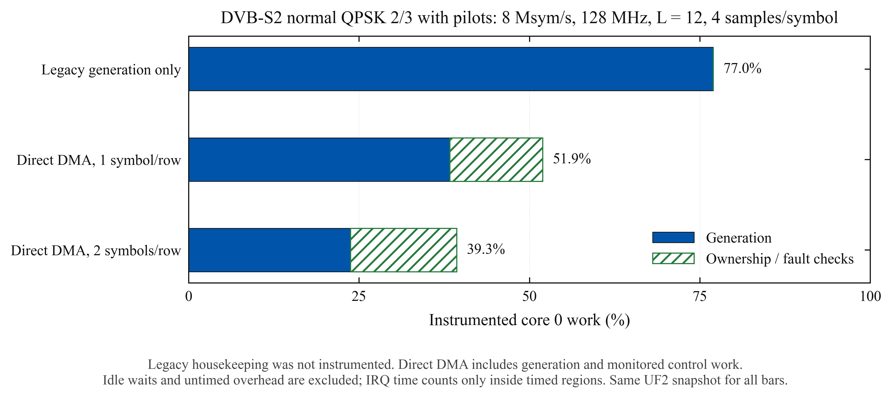

# Yapogee: RP2350 I/Q transmitter experiments

How much of a satellite downlink can fit on one RP2350B?

This firmware builds a DVB-S2 QPSK waveform: BB scrambling, BCH, LDPC, constellation mapping,
PL headers, pilots, PL scrambling, and root-raised-cosine pulse shaping. DMA and PIO send
14-bit I/Q samples over a parallel interface intended for the TI AFE7071.

The experimental pipeline reaches **16 Msym/s at 128 MHz**, with 4 samples/symbol and a
12-symbol RRC filter (α = 0.20). It also accepts transport-stream packets through an
on-chip **32 MHz PV-SPI loopback**, while encoding and transmitting continuously.
The existing autonomous startup profile remains 8 Msym/s.

These are digital measurements on a Pimoroni Pico Plus 2, RP2350B rev A2, at stock voltage.
The new SPI test uses an on-chip master; the earlier external CM5 test ran at 8 Msym/s.
AFE clock/data timing, spectrum, EVM, the RF chain and receiver decoding still need measurement.

## Current results

All rows below use normal QPSK 2/3, pilots, L = 12 and 4 samples/symbol.
The [headroom campaign](results/dual-dma/2026-10-15/README.md) contains exact configurations,
immutable logs, capture checks, firmware hashes and reproduction commands.

| Pipeline | Symbol rate | What was checked |
|---|---:|---|
| Split encoder + direct LUT DMA | 16 Msym/s at 128 MHz | Live encoding and sparse pin capture against the independent waveform reference |
| Split encoder + PV-SPI loopback | 16 Msym/s at 128 MHz | 60 seconds, 117,728 accepted messages with no reported loss, matching CRC chain and sparse waveform capture |
| One-core encoder + direct LUT DMA | 8 Msym/s at 128 MHz; 9.375 at 150 MHz | Encoding and shaping on one core; the other core idle |
| External CM5, earlier sample-buffer pipeline | 8 Msym/s at 128 MHz | Two cameras, 9 Mb/s TS over 20 MHz SPI, 210 s without errors |

At 16 Msym/s, normal 2/3 with pilots carries **20.65 Mb/s of BB data-field capacity**, before
TS and application overhead. The DAC sample rate is **64 MS/s per axis**; the interleaved
bus carries 128 million 16-bit slots/s.

With SPI input, core 0 measured **85.62% active work** and core 1 **93.03% work**, including
TS construction. Without SPI, the split encoder measured 85.48% and 75.76%, respectively.
The one-core path ran at 8 Msym/s with 80.92% active work. These are 60-second digital tests;
the [campaign report](results/dual-dma/2026-10-15/README.md) identifies each firmware image.


Work percentages are instrumented CPU time. The newer core-0 active-loop measurement also
includes loop bookkeeping. Both cores busy-wait when they have no work; the unused part of a
bar is available scheduling budget, rather than a measured sleep state. “Control” in older
plots means **CPU supervision**: checking DMA progress, safe buffer reuse, deadlines and faults.

## How the fast path works

The CPU generates **addresses of precomputed samples**. DMA reads the samples themselves.

1. PIO and DMA receive PV-SPI messages into a queue. Core 1 validates messages and builds
   TS-mode BBFRAMEs in two reusable slots.
2. Core 0 copies and scrambles each BBFRAME, then computes BCH in bounded chunks. Two FEC
   frame slots let this overlap the backend.
3. Core 1 performs LDPC and PL framing, publishing packed I/Q symbol words into an input ring.
4. Core 0 uses its interpolators to turn symbol histories into I/Q LUT addresses. Each
   16-byte table row contains two symbols' worth of samples for one axis.
5. A **control DMA channel** reads one address and writes it to a **sample DMA channel's**
   trigger register. The sample channel transfers four 32-bit LUT words to a PIO FIFO.
   Completion chains back to the control channel for the next address.
6. Four PIO writers alternate I/Q and even/odd rows on the shared bus. HSTX supplies the
   candidate clock. A separate PIO sampler checks finite, sparse snapshots of the output pins.

The control DMA channels move addresses. CPU supervision checks that this hardware pipeline
stays within its buffer and timing contracts. They are separate jobs.

The main improvements are paired LUT rows, additional PIO FIFOs to hide DMA handoff latency,
careful SRAM placement, cheaper fault polling, tiled LDPC transpose/packing, and a compact
mapping loop. The tight encoder leaves are ordinary assembly in
[firmware/src/dvbs2_asm.S](firmware/src/dvbs2_asm.S), with portable C fallbacks.



## Build and reproduce

Requires the Pico SDK 2.2.0, GCC Arm toolchain 14.2, CMake, Ninja, picotool, Python, NumPy and
pyserial. The Makefile defaults to the SDK/toolchain installed by the Pico VS Code extension;
set `PICO_SDK_PATH` and `PICO_TOOLCHAIN_PATH` for another installation.

```sh
make check                    # native encoder/protocol tests and PIO/DMA models; no USB
make build                    # iqbench.uf2 and pvflight.uf2 in firmware/build/
make flash                    # load and verify iqbench on the connected Pico

# On-chip SPI-fed experiment; choose a fresh output directory for every run.
python3 host/dual_trial.py spi --ms 60000 --build firmware/build \
  --out results/dual-dma/local-spi

# Wider comparison, including one-core operation and deliberate fault controls.
python3 host/dual_trial.py qualify --clocks 128000 150000 --build firmware/build \
  --out results/dual-dma/local-qualification

python3 host/plot_dual.py --check
python3 host/plot_dual.py
```

The high-rate tests drive GPIOs. The recorded limits campaign used USB only, with GPIOs
unconnected. The runner does not build or flash firmware; flash the selected build first.
Its SPI profile is restricted to 128 MHz. The four-writer mode uses a different clock/interface
experiment from the original single-writer output; it needs external DAC timing validation.

`iqbench` accepts USB bench commands. `pvflight` starts the stored 8 Msym/s profile without
USB, sends null packets when input is absent, and exposes `status`, `stop` and `start`.
See [autonomous startup](docs/autonomous-startup.md) for the exact behavior and outstanding
board tests. [PV-SPI v1](docs/pv-spi-spec.md) defines the payload interface.

## Research and limits

A separate **pin-free PIO pointer generator** has produced every expected LUT address at an
equivalent component rate above 35 Msym/s. Connecting it to the sample DMA engine is the next
architectural experiment; this component result is not a complete transmitter throughput claim.
The [research notes](results/dual-dma/2026-10-15/research.md) explain the program, resource
budget, table permutation and remaining ownership tests.

The isolated 8PSK shaper works, but the full DVB-S2 8PSK interleaver/mapper is not implemented.
Its current sample-generation cost makes it slower than the optimized QPSK path. Further
8PSK and lower-sampling-rate experiments need their own waveform and reconstruction checks.

The earlier [limits report](results/limits/2026-10-14/README.md),
[direct-DMA campaign](results/dual-dma/2026-10-14/README.md) and
[benchmark history](docs/benchmark-history.md) retain the original measurements and failed probes.
[Filter derivations](docs/derivations.md) explain the reconstruction images and the choice of
4 samples/symbol. [Hardware notes](hardware/devboard/README.md) cover the proposed interface.

## Source map

| Area | Files |
|---|---|
| Run control and default transmitter | `firmware/src/main.c`, `tx.c`, `iqout.c` |
| Direct LUT DMA experiment | `bench_dual.c`, `dual_dma.c`, `iqdesc.c`, `iqpair.c` |
| DVB-S2 encoding | `dvbs2.c`, `dvbs2_asm.S`, `dvbs2_codes.h` |
| SPI transport and TS framing | `pvspi.c`, `pvproto.c` |
| PIO pointer research | `bench_ptr.c`, `ptrprog.h` |
| Independent models and board validation | `reference/`, `host/dual_trial.py`, `host/dual_spi.py` |
| External payload sender | `host/cm5/` |
