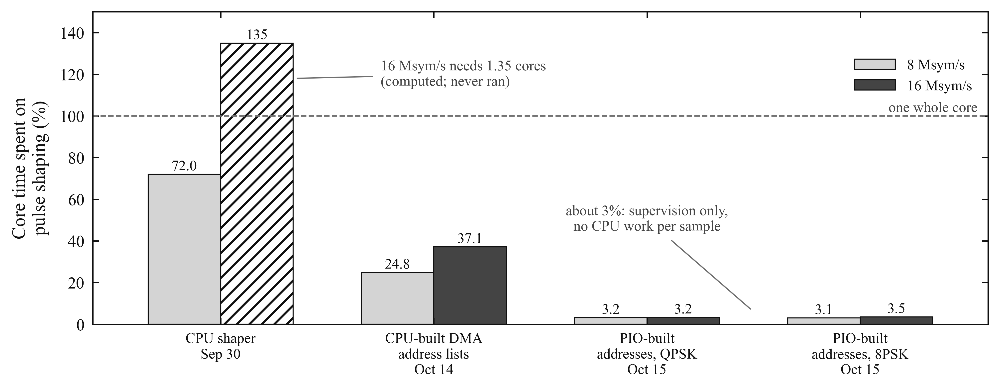
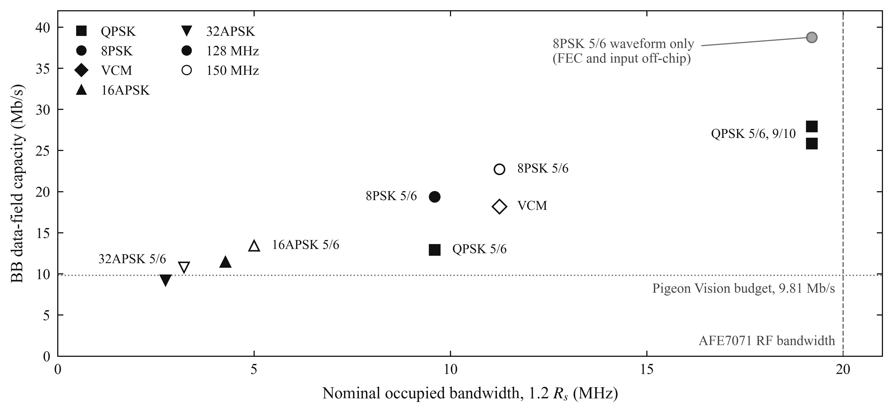
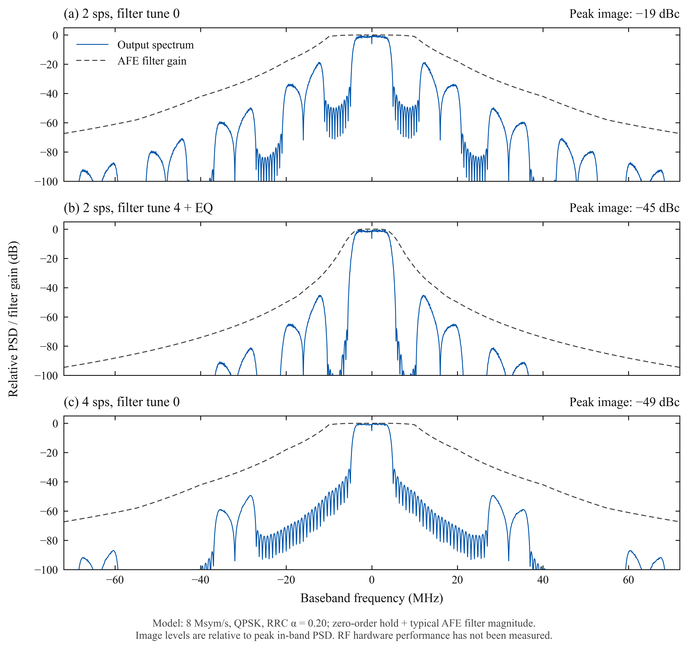
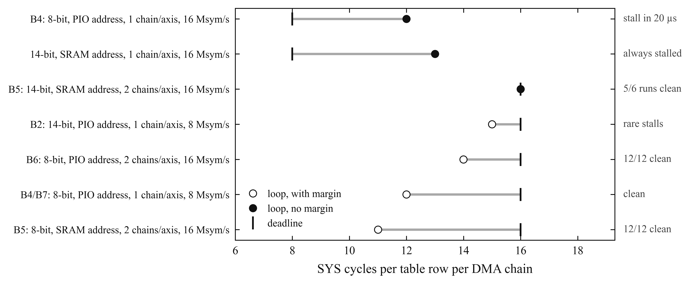
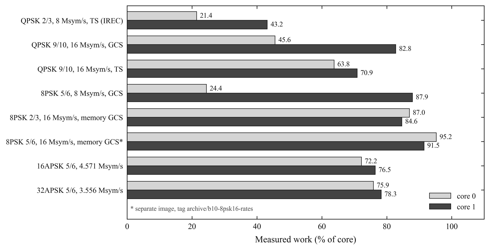
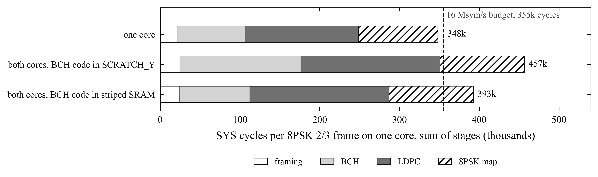
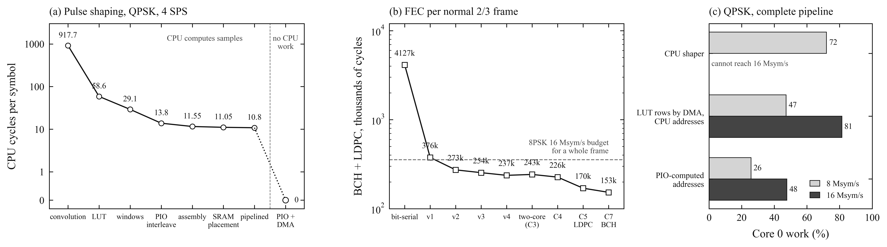
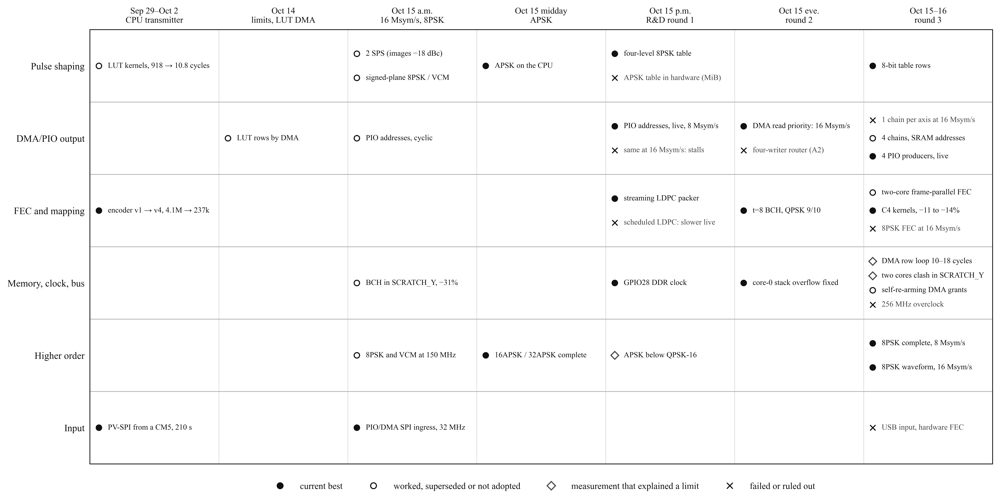

# Yapogee: RP2350B satellite downlink experiments

Can an RP2350 through the power of PIO replace the FPGA that generates a DVB-S2 QPSK waveform for a TI AFE7071 transmitter?

**Digital result: Yes, with margin!!!** Yapogee builds a complete DVB-S2 digital waveform on a
standalone RP2350B: BB framing and scrambling, BCH, LDPC, constellation mapping, PL headers,
pilots, PL scrambling and pulse shaping. DMA and PIO stream the I/Q samples over the parallel
interface proposed for the TI AFE7071, with the AFE's DDR clock generated on GPIO28. The payload
sends bytes over SPI; it does not generate the waveform or perform FEC.

QPSK now runs at **16 Msym/s, the AFE7071's limit at 4 samples/symbol**, with the pulse shaping
done entirely by PIO and DMA: no CPU touches a sample. The best QPSK capacity is **27.94 Mb/s
with 9/10**. **8PSK** now runs as a complete on-chip transmitter at 16 Msym/s too: framing,
BCH, LDPC and mapping split across both cores, shaping in PIO and DMA, **30.97 Mb/s at 2/3**, and
**38.76 Mb/s at 5/6** on its own firmware image. Those 8PSK rates run with thin margins (85 to 95%
of both cores). **16APSK and 32APSK** run as complete SPI/FEC pipelines, slower but working.
Everything uses a 128 MHz system clock (the RP2350 is rated to 150 MHz; 128 MHz gives integer
dividers for the DAC clock) unless a row says 150 MHz.



Pulse shaping used to take 72% of a core at 8 Msym/s and would need 1.35 cores at 16 Msym/s.
With PIO building the table addresses and DMA moving the samples, it takes about 3%, which is
just the supervision loop checking for faults.

Tests use a Pimoroni Pico Plus 2, RP2350B rev A2, stock voltage, USB only and unconnected
external GPIOs. SPI traffic comes from an on-chip master unless stated; the external CM5 camera
test is recorded separately. This repository is the benchmark and the groundwork: flight
firmware will be ported from the best engines here.

## Best setting per transmitter type

Each line is the best measured result for that use; commands are in
[Build and reproduce](#build-and-reproduce) and in each results README.

| Profile | Mode | Engine and image | Capacity | Core 0 / core 1 | Evidence |
|---|---|---|---:|---:|---|
| Pigeon Vision video | QPSK 2/3, 8 Msym/s, TS over SPI | PIO pointer engine (`dualptr`), experiment image | 10.33 Mb/s | 21 / 43% | [q1-qpsk](results/q1-qpsk/2026-10-16/README.md) |
| Fastest QPSK | QPSK 9/10, 16 Msym/s, TS over SPI | `dualptr` with the core-0 TS adapter (`pvkernel 3`) | **27.94 Mb/s** | 64 / 71% | [q1-qpsk](results/q1-qpsk/2026-10-16/README.md) |
| Fastest on main | 8PSK 2/3, 16 Msym/s, complete on-chip | `b9`, experiment image, DMA bus priority 13 | **30.97 Mb/s** | 87 / 85% | [b9-8psk16](results/b9-8psk16/2026-10-16/README.md) |
| Fastest measured | 8PSK 5/6, 16 Msym/s, complete on-chip | `b9` code 8, mask 6395, tag `archive/b10-8psk16-rates` | **38.76 Mb/s** | 95 / 92% | [b10](results/b10-8psk16-rates/2026-10-16/README.md) |
| 8PSK with room to spare | 8PSK 5/6, 8 Msym/s, SPI input | `bench4fec`, 8-bit rows | 19.38 Mb/s | 24 / 88% | [b7-live8](results/b7-live8/2026-10-15/README.md) |
| 16APSK | 16APSK 5/6, 4.571 Msym/s | `benchapskfec` option 1, default image | 14.73 Mb/s | 72 / 77% | [a3-apsk](results/a3-apsk/2026-10-16/README.md) |
| 32APSK | 32APSK 5/6, 3.556 Msym/s | `benchapskfec` option 3, default image | 14.33 Mb/s | 76 / 78% | [a3-apsk](results/a3-apsk/2026-10-16/README.md) |
| Wider input link | 4-bit PV messages, 12.8 MHz clock | `pvwide`, on-chip sender | 47.8 Mb/s in | under 1% to receive | [ingress-wide](results/ingress-wide/2026-10-16/README.md) |

The two 16 Msym/s 8PSK rows read their payload from memory, not from SPI: the existing SPI link
carries 24.1 Mb/s, and the 4-bit link that would carry 31 to 39 Mb/s is not yet joined to an
encoder. 5/6 at 16 Msym/s needs its own image because the encoder's speed depends on where its
code lands in the flash cache: adding the 5 SPS and wide-input code to the same image made it run
dry ([details](results/b10-8psk16-rates/2026-10-16/README.md)). 3/4 at 16 Msym/s ran 46 s
before running dry, so it is not on the list.

## Measured modes

Complete digital pipelines: input, BBFRAME, BCH, LDPC, mapping, PLFRAME, shaping, pins. Every
row passed 60 seconds with every captured sample checked against an independent reference.

| Pipeline | Input | Shaping | Clock | Symbol rate | BB data capacity | Width at α = 0.20 |
|---|---|---|---:|---:|---:|---:|
| QPSK 9/10 + pilots, 4 SPS | SPI, GCS or TS | PIO/DMA | 128 MHz | 16 Msym/s | **27.94 Mb/s** | 19.2 MHz |
| QPSK 5/6 + pilots, 4 SPS | SPI | PIO/DMA | 128 MHz | 16 Msym/s | **25.84 Mb/s** | 19.2 MHz |
| QPSK 5/6 + pilots, 4 SPS | SPI | PIO/DMA | 128 MHz | 8 Msym/s | 12.92 Mb/s | 9.6 MHz |
| QPSK 2/3 + pilots, 4 SPS (Pigeon Vision) | SPI, TS | PIO/DMA | 128 MHz | 8 Msym/s | 10.33 Mb/s | 9.6 MHz |
| QPSK 2/3 + pilots, 4 SPS (`pvflight`, autonomous) | SPI, TS | CPU | 128 MHz | 8 Msym/s | 10.33 Mb/s | 9.6 MHz |
| 8PSK 5/6 + pilots, 4 SPS | memory | PIO/DMA | 128 MHz | 16 Msym/s | **38.76 Mb/s** (own image) | 19.2 MHz |
| 8PSK 2/3 + pilots, 4 SPS | memory | PIO/DMA | 128 MHz | 16 Msym/s | **30.97 Mb/s** | 19.2 MHz |
| 8PSK 5/6 + pilots, 4 SPS, 8-bit table | SPI | PIO/DMA | 128 MHz | 8 Msym/s | **19.38 Mb/s** | 9.6 MHz |
| 8PSK 5/6 + pilots, 2 SPS | SPI | CPU | 150 MHz | 9.375 Msym/s | 22.71 Mb/s | 11.25 MHz |
| Alternating QPSK/8PSK 5/6 (VCM), 2 SPS | SPI | CPU | 150 MHz | 9.375 Msym/s | 18.17 Mb/s mean | 11.25 MHz |
| 16APSK 5/6 + pilots, 2 SPS | SPI | CPU | 128 / 150 MHz | 4.571 / 4.688 Msym/s | **14.73** / 15.10 Mb/s | 5.49 / 5.63 MHz |
| 32APSK 5/6 + pilots, 2 SPS | SPI | CPU | 128 MHz | 3.556 Msym/s | **14.33 Mb/s** | 4.27 MHz |

Waveform only (no FEC on chip): **8PSK at 12.8 Msym/s and 5 samples/symbol** runs 60 s clean
from a cyclic source ([n5-12m8](results/n5-12m8/2026-10-16/README.md)). With 5/6 FEC it would
carry 31.0 Mb/s, and each core would get 443,880 cycles per frame instead of 355,104; the pulse
passes the spectrum-mask model by only 0.03 dB.



Filled markers are 128 MHz, open markers 150 MHz, grey is waveform only. Capacity includes PL
header and pilot time and subtracts the BBHEADER; application throughput is lower. Width is
1.2 × symbol rate, calculated, not measured. Pigeon Vision needs a 9 Mb/s MPEG-TS, which fits
QPSK 2/3 at 8 Msym/s.

## Why 4 samples per symbol

The shaper sends the DAC 4 I/Q samples for every symbol, so at 8 Msym/s the AFE7071's DAC runs
at 32 MS/s (64 M bus words/s, I and Q interleaved), and at 16 Msym/s it runs at 64 MS/s, just
under its 65 MSPS limit. A DAC's output also carries copies of the signal, called images, around
every multiple of its sample rate. The AFE7071 has no interpolator, only a gentle on-chip
low-pass, so the sample rate decides how far out those copies land and how much of them the
filter removes:
- 4 samples/symbol: first image at 27 MHz, modelled at −49 dBc with the widest filter setting.
- 2 samples/symbol: first image at 11 MHz, −19 dBc. It reaches −45 dBc only with the tune-4
  filter and a matching pre-equaliser, and moves ±4 dB for a ±10 % filter-corner error.

The E200 can take "2 samples/symbol" because its AD9363 interpolates to a much higher DAC rate
internally. Details are in [docs/derivations.md §2](docs/derivations.md#2-samples-per-symbol-at-the-afe7071).



## How the hardware shaping works

Pulse shaping is a filter over the last 7 symbols. Each axis only ever takes a few levels: 2 for
QPSK, and 4 for 8PSK after a π/8 rotation. So every possible output is computed once at startup
into a table: 16,384 rows of four 8-bit samples (64 KiB) for 8PSK. At run time:

1. A PIO state machine shifts each symbol's 2-bit code into a rolling 14-bit history and emits
   the table row address (7 instructions per symbol).
2. A control DMA channel copies that address into a sample DMA channel's start register. The
   sample channel copies the row into a PIO writer FIFO, then chains back to the control channel.
3. PIO writers put one sample per 128 MHz clock on GPIO6–13, with IQ_FLAG on GPIO14. Another state
   machine toggles GPIO28 as the AFE's DDR clock: I on the rising edge, Q on the falling edge.
   One register write starts the writers and the clock on the same cycle.

The QPSK engine works the same way with four-symbol rows. The CPU-shaped engines (2 SPS 8PSK,
VCM, APSK) instead sum precomputed table contributions on core 0 and stream the blocks.

One row fetch is a chain of dependent bus operations, measured at 10 to 18 cycles depending on
the row size and how many chains share the bus. A chain must finish each row before its writer
needs it, so 16 Msym/s needs two chains per axis. This one measurement explains every stall we
saw:



## Where the CPU goes

With shaping in hardware, the remaining CPU work is the input, BB framing, BCH, LDPC and mapping.



The FEC is the hard part of 8PSK at 16 Msym/s. The two cores take alternate frames, so each
gets 355k cycles per frame. One 8PSK 2/3 frame cost 348k on one core in round 3, and more when
both cores encoded at once and fought over SRAM. Faster LDPC and mapping kernels (C5, C6), BCH
copies per core and smaller BCH tables (C7, C9), and keeping hot code out of the flash cache got
a 2/3 frame to 260 to 290k with both cores busy:



## How it got here

Every version was measured on the Pico and kept in [results](results/README.md). The CPU
shaper went from 918 to 10.8 cycles per symbol before moving into PIO and DMA, where it costs
nothing per symbol; BCH and LDPC went from 4.1 million to 153k cycles per frame.



Everything tried so far, by thread and date:



## Build and reproduce

Requires Pico SDK 2.2.0, GCC Arm 14.2, CMake, Ninja, picotool, Python, NumPy, Matplotlib and
pyserial. Set `PICO_SDK_PATH` and `PICO_TOOLCHAIN_PATH` if they are not in the Pico VS Code
extension's default locations.

```sh
make check        # native and model validation, no USB
make build        # firmware/build/{iqbench,pvflight}.uf2
# Experiment commands (four-level table, 8-bit rows, PIO producers, FEC and DMA diagnostics):
cmake -S firmware -B firmware/build-exp -G Ninja -DCMAKE_BUILD_TYPE=Release \
  -DIQ4HIST_EXPERIMENT=ON -DCORE0_STACK_SRAM_HI=ON
make build BUILD=firmware/build-exp
python3 host/plot_summary.py && python3 host/plot_history.py   # regenerate the figures from results/
```

The runners never build or flash. Flash the matching image, then add `--port`, a fresh `--out`
and `--expected-git <image git>` to each line:

```sh
# Pigeon Vision: QPSK 2/3, 8 Msym/s, TS over on-chip SPI, PIO pointer engine
python3 host/dualptr_trial.py --ms 60000 --clocks 128000 --cpws 2 --sources 5 --faults 0 \
  --clock-modes 1 --code-index 5 --priority 0 --build firmware/build-exp
# Fastest QPSK: 9/10, 16 Msym/s, TS input with the core-0 TS adapter
python3 host/dualptr_trial.py --ms 60000 --clocks 128000 --cpws 1 --sources 5 --faults 0 \
  --clock-modes 1 --code-index 10 --bch-kernel 3 --bch-bank 1 --priority 13 --pv-kernel 3 \
  --build firmware/build-exp
# Complete 8PSK 2/3 at 16 Msym/s (cpw 2 for 8 Msym/s)
python3 host/b9_trial.py --ms 60000 --cpws 1 --priorities 13 --build firmware/build-exp
# Complete 8PSK 5/6 at 16 Msym/s: build the experiment image from tag archive/b10-8psk16-rates
python3 host/b9_trial.py --ms 60000 --cpws 1 --codes 8 --options 6395 --priorities 13 \
  --build firmware/build-exp
# Complete 8PSK 5/6 at 8 Msym/s with SPI input, 8-bit table
python3 host/iq4fec_trial.py --bits 8 --ms 60000 --cpws 2 --inverts 0 --prios 13 \
  --build firmware/build-exp
# 16APSK / 32APSK complete SPI/FEC path (default image)
python3 host/apsk_fec_trial.py --ms 60000 --clocks 128000 --ldpc-pack 1 --bch-bank 1 \
  --modulations 16 --cpw 7 --options 1 --build firmware/build
python3 host/apsk_fec_trial.py --ms 60000 --clocks 128000 --ldpc-pack 1 --bch-bank 1 \
  --modulations 32 --cpw 9 --options 3 --build firmware/build
# 8PSK waveform at 12.8 Msym/s, 5 samples/symbol
python3 host/iq5quad_trial.py --ms 60000 --cpws 1 --priorities 13 --inverts 0 --build firmware/build-exp
# 4-bit input link with the on-chip sender, 47.8 Mb/s
python3 host/pvwide_trial.py --ms 60000 --widths 4 --halves 5 --faults 0 --build firmware/build-exp
```

Each results README lists its exact commands, image hashes and negative controls.
`pvflight` starts the stored QPSK 2/3 profile without USB; see
[autonomous startup](docs/autonomous-startup.md) and [PV-SPI v1](docs/pv-spi-spec.md).

## Where things are

| Need | Look in |
|---|---|
| Every results folder, grouped by type | [results/README.md](results/README.md) |
| R&D rounds 1–4: what each experiment tried and found | [docs/rd/README.md](docs/rd/README.md) |
| Bounds and strategy | [frontier model](docs/frontier/frontier.md), [strategy report](docs/frontier/strategy-report.md) |
| Filter and sampling derivations, DAC clock | [derivations](docs/derivations.md), [DAC clock](docs/dac-clock.md) |
| History | [benchmark history](docs/benchmark-history.md), [front page of 2026-10-15](docs/history/readme-2026-10-15.md) |

Firmware sources are grouped by area under `firmware/src/`:

| Folder | What is in it | Main host tools |
|---|---|---|
| `app/` | `main.c` (USB command dispatch), `tx.c` (default transmitter, core-1 tasks), `config.h` (pins, buffers) | `iqbench.py` |
| `output/` | PIO/DMA output engines and their tables: `dual_dma.c` (writers, DDR clock, capture), `iqquadptr.c` (QPSK PIO addresses), `iq4hist.c` / `iq5hist.c` (8PSK tables at 4 and 5 SPS), `iq4prod*.c` (PIO producers, IRQ grants), `iqout.c` (CPU-fed output) | `dualptr_trial.py`, `iq4*_trial.py`, `iq5quad_trial.py` |
| `dvbs2/` | DVB-S2 encoder: `dvbs2.c` (BB, BCH, LDPC, QPSK PL), assembly leaves (`*_asm.S`, `dvbs2_bch_fast.S`, `dvbs2_ldpc_c5*.S`), `dvbs2_8psk.c`, `dvbs2_apsk.c`, `c3_fec.c` (two-core frame-parallel FEC) | `c3_fec_trial.py`, `reference/dvbs2/` |
| `ingress/` | Payload input: `pvspi.c` / `pvproto.c` (PV-SPI), `pvwide.c` (4-bit link), `link.c` | `pvwide_trial.py`, `cm5/` |
| `cpu_shaping/` | Superseded CPU pulse shapers: QPSK LUT kernels (`iqgen.c`, `iqasm.S`), 8PSK at 2 SPS (`iq8*.c`) | `iq8live_trial.py`, `vcm_trial.py` |
| `apsk/` | 16APSK and 32APSK CPU shaping kernels (`iq16*`, `iq32*`) | `apsk_*_trial.py` |
| `bench/` | One file per console benchmark command: `bench_b9.c` (complete 8PSK at 16 Msym/s), `bench_dual.c` (`dualptr`), `bench4fec.c`, `bench5quad.c`, `bench_apsk_fec.c`, `dmaloop.c`, `bench_c3_*.c` and the rest | the matching `*_trial.py` |

Headers are included by bare name from any folder; `firmware/CMakeLists.txt` and `host/fwsrc.py`
list the folders.

All work that runs together in one image lives on `main`. Each former experiment branch is kept
as a tag `archive/<branch>` so every recorded firmware commit stays reachable; C9 and B10 (8PSK
5/6 at 16 Msym/s) are only on their tags. The transmitter hardware is designed in
[Yapogee](https://github.com/Rivercraft911/yapogee).

Of course, none of this shows RF performance: spectrum and EVM after the AFE, clock jitter, LO leakage, PA
behaviour and so much more. This is purely the waveform generation.

No real receiver has decoded this output yet.... Coming soon to a repo near you!
