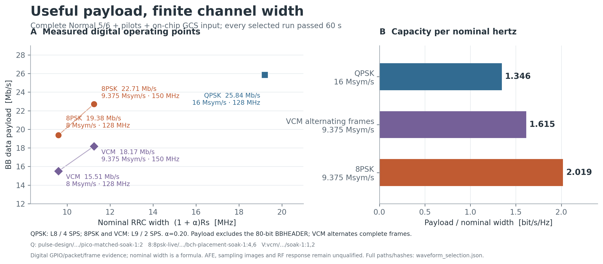

# Yapogee: RP2350B satellite downlink experiments

Can an RP2350 through the power of PIO replace the FPGA that generates a DVB-S2 QPSK waveform for a TI AFE7071 transmitter?

**Digital result: Yes, with margin!!!** Yapogee builds a complete DVB-S2 digital waveform on a standalone RP2350B:
BB framing and scrambling, BCH, LDPC, constellation mapping, PL headers, pilots,
PL scrambling and pulse shaping. DMA and PIO stream 14-bit I/Q samples over the
parallel interface proposed for the TI AFE7071. The payload sends bytes over SPI;
it does not generate the waveform or perform FEC.

The experimental branch now supports **16-Msym/s QPSK**, **9.375-Msym/s 8PSK**, and
**continuous QPSK/8PSK frame switching**. All three have 60-second digital results.
The fastest tested BB data-field capacity is **25.844 Mb/s with QPSK 5/6**.
The earlier autonomous startup profile remains QPSK 2/3 at 8 Msym/s.

Tests use a Pimoroni Pico Plus 2, RP2350B rev A2, stock voltage, USB only and
unconnected external GPIOs. Recent SPI traffic comes from an on-chip master.
Actual AFE timing, reconstruction images, RF spectrum/EVM and receiver decoding
still need measurement. The earlier external CM5 camera test is recorded separately.

## Measured modes

| Complete digital pipeline | Clock | Symbol rate | BB data capacity | Nominal width at α = 0.20 |
|---|---:|---:|---:|---:|
| QPSK 5/6 + pilots, L8 / 4 SPS | 128 MHz | 16 Msym/s | **25.844 Mb/s** | 19.2 MHz |
| 8PSK 5/6 + pilots, L9 / 2 SPS | 128 MHz | 8 Msym/s | 19.378 Mb/s | 9.6 MHz |
| 8PSK 5/6 + pilots, L9 / 2 SPS | 150 MHz | 9.375 Msym/s | **22.709 Mb/s** | 11.25 MHz |
| Alternating QPSK/8PSK 5/6, common L9 / 2 SPS | 150 MHz | 9.375 Msym/s | 18.170 Mb/s mean | 11.25 MHz |

The [waveform campaign](results/waveforms/2026-10-15/README.md) links exact
configurations, immutable run logs, independent capture checks, failed controls,
source archives and firmware hashes. Capacity includes header/pilot time and
subtracts BBHEADER bits; application throughput is lower. Width is calculated,
not an RF measurement. The VCM experiment keeps the same symbol clock and pulse
across frames; it does not switch to the separate 16-Msym/s QPSK engine.



Exact **16APSK and 32APSK output components** now sustain **8 Msym/s at 128 MHz**
and **9.375 Msym/s at 150 MHz**, with 60-second results for both. Two cores build
alternating sample blocks, including runtime label mapping and filter history.
At 150 MHz, measured work occupies about **86% per core for 16APSK** and **94%
for 32APSK**. A pair mapper, byte-offset keys and separate SRAM code banks bring
32APSK up to the same rate as 16APSK. These tests use cyclic geometric labels;
complete SPI/FEC/PLFRAME production is still separate. See the
[two-core APSK results and limits](results/apsk-dual/2026-10-15/README.md) and
[earlier kernel experiments](results/apsk-frontier/2026-10-15/README.md).


The L8 QPSK encoder/output also passed 60 seconds on one core at **10.667 Msym/s
at 128 MHz**, and **12.5 Msym/s at 150 MHz**. Those tests use a synthetic BB source;
live SPI input at the one-core limits still needs its own trial.

## How the engines work

The fast QPSK engine generates **addresses of precomputed samples**:

1. PIO/DMA receive SPI packets; the two cores build BBFRAMEs and run BCH/LDPC/PL mapping.
2. Core 0 uses its interpolators to turn packed symbol history into LUT addresses.
3. A control DMA channel moves an address into the sample DMA channel's trigger register.
4. The sample DMA copies that row of I/Q samples into the output PIO FIFO, then chains
   back to the control DMA. Multiple PIO writers hide the handoff delay.

The four-symbol L8 QPSK table occupies 64 KiB. A hardware-pointer experiment can
also generate addresses in two pin-free PIO state machines; its qualification is
tracked separately from the complete SPI/FEC path. Its cyclic-PRBS test sustained
**16 Msym/s for 60 seconds with 3.38% measured core-0 supervision and core 1 idle**.
Connecting that engine to live SPI/FEC production is the next integration step.

The 8PSK/VCM engine uses **two signed amplitude planes**. A fused interpolator/LUT
kernel sums their precomputed contributions into small sample blocks. DMA and PIO
stream those blocks. A constant π/8 rotation represents QPSK, 8PSK, headers and
pilots in the same engine, preserving filter history across mode changes.

“Control” has two meanings in the measurements: **control DMA** transports LUT
addresses, while **CPU supervision** checks progress, safe reuse and faults.
CPU bars report instrumented work or active-loop time, as labeled. Waiting cores
spin; spare scheduling budget is not a measured sleep state or power saving.

The largest recent changes are packed Boolean mapping, shorter offline-designed
pulses, hardware SPI admission credits and SRAM bank placement. A one-line section
move cut the contended BCH stage by about **31%**, rescuing the complete 8PSK path.
See the [controlled A/B/A evidence](results/memory-placement/2026-10-15/comparison.json)
and [campaign discussion](results/waveforms/2026-10-15/README.md).

## Build and reproduce

Requires Pico SDK 2.2.0, GCC Arm 14.2, CMake, Ninja, picotool, Python, NumPy,
Matplotlib and pyserial. Set `PICO_SDK_PATH` and `PICO_TOOLCHAIN_PATH` if they are not in the
Pico VS Code extension's default locations.

```sh
make check                    # native/model validation; no USB
make build                    # firmware/build/{iqbench,pvflight}.uf2
make flash                    # load and verify iqbench on the Pico

# Build and flash first. Each trial needs a fresh output directory.
python3 host/iq8live_trial.py --ms 60000 --build firmware/build \
  --out results/8psk-live/local
python3 host/vcm_trial.py --ms 60000 --build firmware/build \
  --out results/vcm/local

# Two-core 32APSK mapping/shaping component, without SPI/FEC.
python3 host/apsk_live_trial.py --ms 60000 --modulations 32 --mappers 3 \
  --placements 1 --schedules 2 --cpw 4 --build firmware/build \
  --out results/apsk-dual/local

# Hardware LUT-address generation; cyclic PRBS, without SPI/FEC.
python3 host/quadlive_trial.py --ms 60000 --clocks 128000 --cpws 1 --faults 0 \
  --build firmware/build --out results/quad-pointers/local

# Full QPSK SPI comparison, including TS and generic continuous input.
python3 host/dual_trial.py gcs --clocks 128000 --ms 60000 \
  --writers 4 --row-symbols 4 --quad-profile 1 --code-index 8 --map-kernel 1 \
  --build firmware/build --out results/qpsk-codes/local
```

These tests drive GPIOs. The runners do not build or flash; use the matching
source and binary snapshots, and pass `--expected-git` to pin firmware identity.
The 2-SPS and multi-writer interfaces require their own external DAC qualification.
See [PV-SPI v1](docs/pv-spi-spec.md) for the payload protocol.

`iqbench` accepts USB experiment commands. `pvflight` starts the stored 8-Msym/s
QPSK profile without USB and exposes `status`, `stop` and `start`; see
[autonomous startup](docs/autonomous-startup.md). The new waveform modes are opt-in
lab commands and do not replace that startup profile.

## Evidence and source map

The earlier [qualified QPSK campaign](results/dual-dma/2026-10-15/README.md),
[limits report](results/limits/2026-10-14/README.md) and
[benchmark history](docs/benchmark-history.md) preserve previous results.
The retained `experiment/yapogee-limits` checkpoint is `4b779c0`; current R&D is on
`experiment/yapogee-next-waveforms`. Nothing has been merged or released from it.
[Filter derivations](docs/derivations.md) explain reconstruction images and SPS;
[hardware notes](hardware/devboard/README.md) cover the proposed interface.

| Area | Files |
|---|---|
| Run control and default transmitter | `firmware/src/main.c`, `tx.c`, `iqout.c` |
| Direct LUT DMA and QPSK | `bench_dual.c`, `dual_dma.c`, `iqdesc.c`, `iqquad.c` |
| Complete 8PSK / VCM experiment | `bench8live.c`, `dvbs2_8psk.c`, `dvbs2_qpsk8.c`, `iq8quad.c` |
| APSK components | `bench_apsk_live.c`, `iq16fast_asm.S`, `iq32mapkeys_pair.c`, `iq32offsets_asm.S`, `bench32map.c`, `bench32bus.c` |
| DVB-S2 FEC / mapping | `dvbs2.c`, `dvbs2_asm.S`, `dvbs2_map_asm.S` |
| SPI ingress | `pvspi.c`, `pvproto.c`, `bench_pvstress.c` |
| PIO-generated LUT pointers | `iqquadptr.c`, `bench_quadptr.c`, `bench_quadlive.c` |
| Independent validation | `reference/`, `host/dual_trial.py`, `host/iq8live_trial.py`, `host/vcm_trial.py` |
| External payload sender | `host/cm5/` |

Of course, none of this shows RF performance: spectrum and EVM after the AFE, clock jitter, LO leakage, PA
behaviour and so much more. This is purely the waveform generation.

No real receiver has decoded this output yet.... Coming soon to a repo near you!
