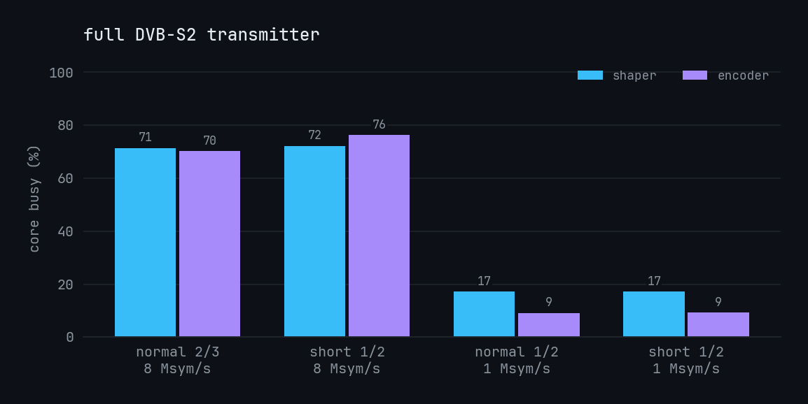
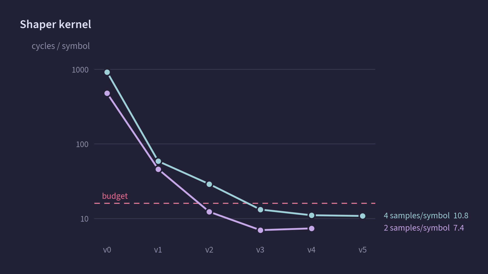
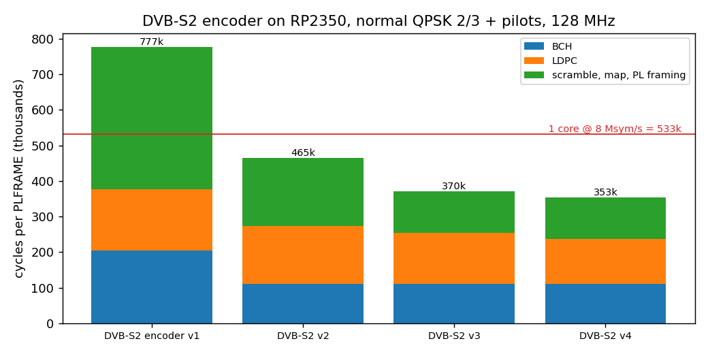

# Benchmark history

This is the earlier README's baseline and optimization snapshot, through the campaign
preceding the current 2026-10-15 qualification work. Measurements span several revisions;
the per-run logs identify their exact source and settings. CPU loads, resource allocations
and verification coverage below are historical, not the current firmware's figures.

The subsequent [limits report](../results/limits/2026-10-14/README.md) and
[direct LUT DMA report](../results/dual-dma/2026-10-14/README.md) record the next experiments.
See the [main README](../README.md) for the current result. All results here concern digital
waveform generation; they do not qualify the AFE, RF spectrum, EVM or satellite link.

## Baseline measurements

Unless noted otherwise: Pico Plus 2, 128 MHz, SDK 2.2.0, GCC 14.2.

| Test | Historical result |
|---|---|
| Full TX, DVB-S2 normal QPSK 2/3 + pilots, 8 Msym/s, N=4, L=10 | Encoder 70.4% (core 1), shaper 72.0% (core 0); 14,426 frames in 60 s; zero underruns; 28,656 captured bus words, zero mismatches |
| Full TX, normal 1/2 + pilots, 1 Msym/s, N=8 | Encoder 9.2%, shaper 17.2%; no faults, capture exact |
| Full TX, short 1/2 + pilots, 1 Msym/s, N=8 | Encoder 9.3%, shaper 17.2%; no faults, capture exact |
| Shaper kernel, N=4, L=10 or 12 (`lut_asm_p`) | 10.80 cycles/symbol; 11.9 Msym/s per core |
| Shaper kernel, N=8 (`lut_asm`) | 20.9 cycles/symbol |
| DVB-S2 encoder, normal 2/3 + pilots | 353k cycles/frame: BCH 110k, LDPC 127k, framing 116k; a later build in this snapshot measured 357k |
| DVB-S2 encoder, short 1/2 + pilots | 93.5k cycles/frame |
| Shaper streaming with PIO input link, four lanes and READY flow control | 67.8% of one core at 8 Msym/s; 16.0 Mb/s received |
| Input link limit, one lane, on-chip loopback | 21.3 and 32 MHz SCK passed; 16 MHz flagged as insufficient for the 16 Mb/s coded input |
| Streaming at 150 MHz, two clocks/word, 75 Mword/s | 9.375 Msym/s, no faults |
| `pvtx`: PV-SPI v1 TS → normal QPSK 2/3 + pilots, 8 Msym/s, L=12, Kaiser β=1; on-chip master at 21 MHz, 60 s | 58,866 messages (981/s), zero errors; BBFRAMEs match the gr-dtv-checked reference; encoder 78.9%, shaper 75.6%; capture exact |
| `pvtx` from a real CM5: two IMX900 cameras, 9 Mb/s TS, PV-SPI at 20 MHz, 210 s | 179,818 messages, CRC chains equal, zero errors or underruns; Python sender reduced each camera from 30.0 to 28.4 fps |
| `pvtx` from the native sender in the CM5 capture process, 120 s | 102,801 messages, CRCs matched, zero errors or underruns; 29.99 fps per camera; [run records](../results/cm5-spi/) |

L is the filter length in symbols. The `pvtx` profile uses L=12 with a Kaiser window,
whose reference spectrum model passes the DVB-S2 mask. The older optimization and full-TX
runs used L=10. Kernel speed was the same, while the shaper's measured share rose from
72% to about 76% in the full L=12 transmitter.

The correctness evidence at this snapshot was:

- Native firmware matched the [Python DVB-S2 reference](../reference/dvbs2/) for all
  21 QPSK codes, with and without pilots. Device CRCs covered four codes.
- The Python reference matched GNU Radio gr-dtv commit `aee9fd3` at five stages in all
  42 configurations; [reference checks and provenance](../reference/dvbs2/README.md).
- The shaper matched the [Python LUT model](../reference/iqlut.py) bit for bit, and that
  model matched direct convolution within 0.52 LSB.
- Stream checks captured the output pins with a PIO state machine synchronized to the
  output state machine. A real receiver had not yet decoded this output.

## Optimization record

Each measurement is appended to [optimization-log.jsonl](../results/optimization-log.jsonl)
with the git revision, clock, parameters and verification. From the repository root,
`make plots` regenerates the progress figures and `make analyze` regenerates filter figures,
as 600 dpi PNG, SVG and PDF files in [results/plots](../results/plots/).

Shaper, N=4, L=10, cycles/symbol. The per-core budget at 8 Msym/s and 128 MHz is 16 cycles.

| Step | Cycles/symbol | Change |
|---|---|---|
| v0 `conv` | 917.7 | Direct convolution |
| v1 `lut_shift` | 58.6 | Lookup table, shift-register history |
| v2 `lut_win` | 29.1 | 16-symbol windows; GCC spills and packs with UXTH/ORR |
| v3 `lut_pair` | 13.8 | PIO interleaves I/Q; CPU stores table words unchanged |
| v4 `lut_asm` | 11.55 | Thumb-2, eight instructions/symbol; predicted 11.5 |
| v4 + placement | 11.05; stream 73.3% → 69.2% | Tables in SRAM4–7, DMA ring in SRAM0–3, code in SRAM8 |
| v5 `lut_asm_p` | 10.80; stream 67.8% | Software pipelining; estimated floor about 10 |

DVB-S2 normal 2/3 + pilots, thousands of cycles/frame. At 8 Msym/s and 128 MHz,
one core has about 533k cycles per frame.

| Step | Frame | BCH | LDPC | Framing | Change |
|---|---|---|---|---|---|
| Serial | — | 1356 | 2771 | — | Bit-serial implementation of the standard |
| v1 | 777 | 204 | 172 | 401 | Byte-table BCH, 360-bit group LDPC |
| v2 | 465 | 110 | 163 | 192 | Slicing-by-four BCH, 32-bit symbol stream |
| v3 | 370 | 110 | 144 | 116 | Unrolled transpose, scrambling folded into the interleaved bit domain |
| v4 | 353 | 110 | 127 | 116 | Streaming rotate-XOR assembly; GCC had hoisted 24 loads and spilled |

## Sampling and physical-interface models

At 8 Msym/s with four samples/symbol, each AFE7071 DAC runs at 32 MS/s and the interleaved
I/Q bus carries 64 Mword/s. DAC images appear around multiples of the sample rate. The
AFE7071 has no digital interpolator, and its on-chip analog low-pass filter provides limited
rejection, so the sample rate sets the image spacing and affects the required filtering.

The earlier [sample-rate/filter model](derivations.md#2-samples-per-symbol-at-the-afe7071)
predicted a first image at 27 MHz and −49 dBc for four samples/symbol with the widest filter.
At two samples/symbol, it predicted an image at 11 MHz and −19 dBc. The latter reached about
−45 dBc only with tune-4 filtering and a matching digital pre-equalizer, and moved about ±4 dB
for a ±10% filter-corner error. These are modeled values, not RF measurements. The E200's
AD9363 can accept two samples/symbol because it interpolates internally to a higher DAC rate;
the linked derivation records the comparison.

The earlier parallel-bus setup/hold estimate was about 5.7 ns at 64 Mword/s, against a stated
1 ns requirement. It used RP2350 QMI pad data rather than a PIO timing specification;
see the [development-board notes](../hardware/devboard/README.md). This remains an estimate,
not a measured PIO-to-AFE timing margin.

## Historical resource snapshot

These allocations were listed in the earlier README's experimental build. They describe
that build, including its 128 KiB sample ring, rather than the later direct-LUT DMA engine.
Preserve the corresponding ELF map when comparing memory layouts.

| Resource | Earlier allocation |
|---|---|
| SRAM0–3, 256 KiB | 33.9 KiB `.data` hot code; 149.0 KiB `.bss`, including the 128 KiB DMA ring; 64 KiB input rings in a separate aligned NOLOAD section; 2 KiB heap |
| SRAM4–7, 256 KB as originally reported | 251.6 KB: 64 KB shaper tables, 56 KB capture, DVB-S2 buffers and tables; 4.4 KB free |
| SRAM8 | 1.2 KB hot kernels, plus the core 1 stack |
| PIO | PIO0 output and verification capture; PIO1 four-lane test link; PIO2 PV-SPI receiver, CS watcher and test emulator |
| DMA | Two output, one capture, one PV-SPI plus two emulator channels, or two link channels |
| GPIO | 0–16 AFE bus: D0–13, IQ_FLAG, spare, CLK_IO; 17–22 PV-SPI or four-lane link |

The source snapshot mixed KB and KiB labels in this resource table; the original values and
labels are retained here rather than silently reinterpreted. They should not be summed as a
new allocation or used to infer current free memory.

## Complete APSK integration, 2026-10-15

The [full APSK campaign](../results/apsk-fec/2026-10-15/README.md) adds live
on-chip SPI input, BB framing, BCH/LDPC and standard PL mapping to the earlier
native-coordinate shapers. Both modes pass 60 seconds at both supported clocks.

| Normal 5/6 + pilots, two cores | 128 MHz | 150 MHz | BB data capacity at 150 MHz |
|---|---:|---:|---:|
| 16APSK, L8 / 2 SPS | 3.556 Msym/s | 4.167 Msym/s | 13.424 Mb/s |
| 32APSK, L8 / 2 SPS | 2.286 Msym/s | 2.679 Msym/s | 10.796 Mb/s |

The previous 9.375-Msym/s APSK results measure mapping/shaping components.
The complete path is limited by the encoder core, particularly PL mapping.
The new report preserves the initial implementation, packing improvements,
failed controls, exact captures, image/source hashes and a proposal for sharing
PL work between cores. No AFE or RF receiver was attached.
