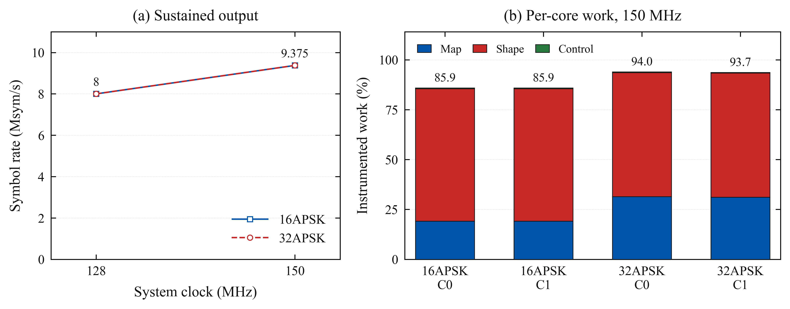

# Two-core APSK mapping and output

Both **16APSK and 32APSK sustain 8 Msym/s at 128 MHz and 9.375 Msym/s at
150 MHz**, each for 60 seconds. Runtime geometric-label mapping, filter history,
pulse shaping and DMA/PIO output are included. All four runs have zero reported
underruns, ownership errors, idle substitutions or TX stalls; each saved GPIO
capture matches an independent FIR reference across all 8,192 halfwords.

These are digital component results on a USB-only Pimoroni Pico Plus 2
(RP2350B rev A2), stock voltage, with external GPIOs unconnected. The source is
an 8,192-symbol cyclic PRBS label sequence. SPI admission, BCH/LDPC, DVB-S2 bit
labeling and complete PLFRAME production are not part of this experiment.
Neither the AFE nor an RF receiver is connected.



The left panel shows the four 60-second passing points; both modes coincide.
The right panel separates measured mapping, shaping and publication/control work
for each core at 150 MHz. Polling waits are excluded, so the unused fraction is
scheduling budget, not measured sleep or power savings. The figure follows the
older repository plot style. [Selection and provenance](../../plots/apsk-dual-2026-10-15/selection.json)
keep methods outside the graphic; SVG and PDF exports are beside the PNG.

## What two cores buy

| Schedule at 150 MHz | 16APSK | 32APSK | Duration |
|---|---:|---:|---:|
| One core maps and shapes | 5.357 Msym/s | 4.6875 Msym/s | 3 s controls |
| Core 1 maps; core 0 shapes | 6.25 Msym/s | 6.25 Msym/s | 3 s controls |
| Both map and shape alternating blocks | **9.375 Msym/s** | **9.375 Msym/s** | **60 s each** |

Each producer owns alternate slots in a four-block output ring. A block contains
1,024 symbols, or 2,048 packed sample words at 2 SPS. A core prepares the history
for its block, maps labels, shapes samples, then publishes the completed slot.
DMA reads only published slots. Each producer waits for DMA completion before
reusing its slot. Native tests reorder blocks to exercise block independence
and source wraps.

Staging only the mapper leaves one core doing all shaping. Giving each core a
complete block makes shaping parallel too. At the passing 150 MHz point:

| Mode | Mapping cycles/symbol | Shaping cycles/symbol | Work, core 0 / core 1 |
|---|---:|---:|---:|
| 16APSK | 6.12 | 21.23 | 85.85% / 85.86% |
| 32APSK | 10.02 | 19.89 | 93.97% / 93.69% |

Stage costs are averages over both producers. Total work also includes history,
publication and local bookkeeping. Interrupts remain enabled. These contended
pipeline measurements differ from isolated kernel timings.

## Changes that mattered

The existing exact 16APSK pair kernel works with a small label-packing lookup.
32APSK required three further changes:

1. A **16 KiB pair mapper** forms two successive rolling keys together. It
   precomputes radix-17 coordinate contributions instead of repeating scalar
   coordinate conversion and key construction for every symbol. The standalone
   canonical mapper falls from 16.13 to 9.51 cycles/symbol against the matched
   scalar baseline; live contention raises the final measured cost to about 10.
2. **Byte-offset keys** store each row index multiplied by eight. The shaper can
   then address its tables directly. This removes six instructions per two
   symbols: the hot loop shrinks from 33 to 27 instructions while preserving
   every output sample. The scaled pair mapper uses an even 1,024-symbol chunk;
   its separate five-symbol history prefix is handled explicitly.
3. **Separate SRAM code banks** give each core its own identical 162-byte shaping
   leaf. The mapper remains in cached flash. CMake generates the two copies from
   the original assembly by changing only its name and section.

The same final image was tested SRAM → flash → SRAM at 150 MHz/9.375 Msym/s.
Both SRAM trials passed three seconds with exact captures. The flash trial
underran after 477 µs. This [A/B/A comparison](sram-aba-1/comparison.json)
supports the code-placement change independently of the arithmetic change.
Earlier [bus diagnostics](components-1/runs.jsonl) also show contention during
concurrent flash execution. Their bus events are not per-core lost-cycle totals.
Adding a 1 µs polling interval alone did not recover the faster rate.

## Current limits

At 2 SPS, one symbol takes `4 × CPW` system clocks on the interleaved bus.
CPW 4 gives 8 Msym/s at 128 MHz and 9.375 Msym/s at 150 MHz. The next tested
integer setting, CPW 3, requests 10.667 and 12.5 Msym/s respectively; both modes
fail with explicit underruns. Those failures are retained as deadline controls.
No fractional-divider frontier was measured, so 9.375 Msym/s is the highest
tested sustainable discrete rate, not an absolute silicon limit.

The 32APSK shaping tables occupy 117,912 bytes and its pair mapper adds 16,384
bytes: **134,296 bytes total** before source, key and output buffers. The 16APSK
shaping tables occupy 139,264 bytes. These experiments borrow existing arenas
while the transmitter is idle; the two modulation tables are not resident
together. Allocation for a complete modem still needs integration work.

The final link retains both 2 KiB stacks, but scratch X has only **16 bytes**
between code and stack; scratch Y has 544 bytes. Low-RAM space up to the heap
limit includes the reserved 1 KiB minimum heap, with only 740 additional bytes
in `iqbench` and 196 in `pvflight`. Further SRAM placement must account for
these margins. See the [validation archive](validation/).

For a complete transmitter, FEC is a substantial additional cost. Reusing the
existing normal-frame 5/6 ingress/BB/BCH/LDPC measurement of 277,171.74 cycles
per frame gives this **planning estimate**, assuming perfect division of work:

| Mode | Measured component work | Projected FEC work | Estimated two-core CPU budget, 150 MHz |
|---|---:|---:|---:|
| 16APSK | 27.475 cycles/symbol | 16.611 cycles/symbol | **6.80 Msym/s** |
| 32APSK | 30.026 cycles/symbol | 20.781 cycles/symbol | **5.90 Msym/s** |

The formula is `2 × clock / (component cycles/symbol + FEC cycles/symbol)`.
Pilot-bearing normal frames contain 16,686 on-air symbols for 16APSK and 13,338
for 32APSK. These estimates reuse another mode's ingress/FEC measurement; they
are neither measured APSK modem rates nor guaranteed deadlines. Actual mapping,
contention, scheduling and memory allocation can change them. The component
result therefore does not establish a complete 9.375-Msym/s APSK transmitter.

## Evidence and reproduction

| Evidence | Scope |
|---|---|
| [16APSK soak](dual16-soak-1/) | Both clocks, 60 s; frozen build 3 |
| [32APSK offset/SRAM soak](dual32-offset-soak-1/) | Both clocks, 60 s; frozen build 4 |
| [Final-image 16APSK regression](dual16-final-image-regression-1/) | Both clocks, 3 s; build 4 |
| [Schedule and mapper frontier](pair16-frontier-1/) | 16APSK and initial 32APSK pair mapper controls |
| [Offset/SRAM frontier](offset-sram-frontier-1/) | Placement, schedule and deadline controls |
| [16APSK deadline failures](dual16-deadline-negative-1/) / [32APSK failures](dual32-deadline-negative-1/) | Both clocks, CPW 3, final image |
| [Earlier pair-mapper soak](dual32-pair-soak-1/) | 32APSK, 7.5 Msym/s, 60 s at 150 MHz |
| [Initial weighted mapper](weighted-frontier-1/) / [polling control](polling-frontier-1/) | Retained intermediate limits |
| [Component timings and bus counters](components-1/) | Mapping alternatives and contention diagnostics |
| [Native/model validation](validation/) | Full check log, source identity, stack and placement audits |

Builds [1](build-1/), [2](build-2/), [3](build-3/) and [4](build-4/) retain source
archives, per-file SHA-256 hashes, build logs and flash verification. They share
the firmware label `16f9a51be7-dirty`; the binary and source hashes distinguish
them. Build 4's `iqbench.uf2` SHA-256 is
`554bb69b6bc0b2b29dfc12ab92a959dc50b58c15d15bd812e010ab4cfcd90e32`.
Saved captures are independent of the mapper's internal key representation.
Older drivers are frozen where the command schema differed.

After building and flashing the matching image, use a fresh output directory:

```sh
python3 host/apsk_live_trial.py --ms 60000 --modulations 32 --mappers 3 \
  --placements 1 --schedules 2 --cpw 4 --expected-git YOUR_FIRMWARE_LABEL \
  --build firmware/build --out results/apsk-dual/local
```

For 16APSK use `--modulations 16 --mappers 0 --placements 0`. Schedules 0, 1
and 2 select serial, staged and alternating producers. The runner does not
build or flash. It checks configuration, durations, faults, table/source CRCs
and bounded capture alignment against an independent reference.

`make check` passes the native/model suite. New coverage includes all 4,913
row offsets, all supported 32APSK ring ratios, scaled pair chunks, 720 reordered
block cases, all signed bus halfwords for CPW 3–8, and metadata/capture
negative controls. The plotting validator also rejects altered source hashes,
wrong configurations, incomplete runs and bad captures. The board was returned
to [128 MHz, idle](final-board.json).
