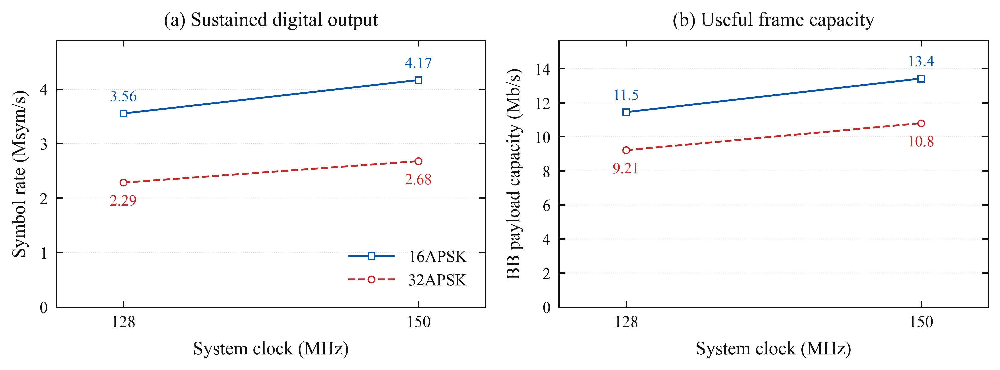

# Complete 16APSK and 32APSK digital pipeline

The standalone Pico now receives **PV-SPI**, constructs **GCS BBFRAMEs**, runs
**BB scrambling, BCH and LDPC**, maps complete **DVB-S2 APSK PLFRAMEs**, shapes
their samples, and drives the I/Q bus through DMA/PIO. All four configurations
below passed **60 seconds** on two cores, at stock voltage.

| Mode | Clock | CPW | Symbol rate | BB data-field capacity | Core 0 / core 1 work |
|---|---:|---:|---:|---:|---:|
| 16APSK | 128 MHz | 9 | **3.555556 Msym/s** | **11.455512 Mb/s** | 57.39% / 96.24% |
| 16APSK | 150 MHz | 9 | **4.166667 Msym/s** | **13.424428 Mb/s** | 57.37% / 96.28% |
| 32APSK | 128 MHz | 14 | **2.285714 Msym/s** | **9.212776 Mb/s** | 59.47% / 94.27% |
| 32APSK | 150 MHz | 14 | **2.678571 Msym/s** | **10.796221 Mb/s** | 59.49% / 94.35% |

These are normal 5/6 frames with pilots, Gold code 0, L8 / 2 SPS, outer-radius-one
constellations and unit-radius headers/pilots. BB capacity is
`Rs × 53760 / frame_symbols`: it subtracts the 80-bit BBHEADER and includes
header/pilot airtime, but still includes GCS overhead/padding. It is not
application goodput. The [ETSI standard](https://www.etsi.org/deliver/etsi_en/302300_302399/30230701/01.04.01_60/en_30230701v010401p.pdf)
defines the interleaver, bit labels, MODCOD, header, pilots, scrambling and the
admitted amplitude normalization used here.

The Pimoroni Pico Plus 2 (RP2350B rev A2) has **USB only and externally
unconnected GPIOs**. A PIO state machine supplies the SPI master traffic; the
real PIO slave, DMA, admission credits and packet checks run on the device.
The host only sends commands and reconstructs a finite window for validation.
An external payload computer, AFE and RF receiver are not part of this test.



Every point requires a passing 60-second record, exact finite capture and full
90-symbol PLHEADER coverage. [Selection and provenance](../../plots/apsk-fec-2026-10-15/selection.json)
pin the rows, references, archived source, binaries and verified flash input.
SVG and PDF exports are beside the PNG.

## Work and ownership

Core 1 consumes SPI messages, constructs a BBFRAME, runs FEC, interleaves coded
bits, maps their constellation points, inserts headers/pilots and applies Gold
rotation. It publishes native I/Q words in batches of 64. Core 0 shapes
1,024-symbol blocks and releases input storage only after it has finished reading
the block and its eight-symbol history. Four owned output slots feed chained
DMA and the output PIO.

The 16APSK stream packs four symbols per word. Its 16,686-symbol frame leaves
two symbols in the partial word, so that partial word survives into the next
frame. The 32APSK stream packs two symbols per word; its 13,338-symbol frame
aligns naturally. Neither path flushes or pads between frames. Progressive
publication gives 32APSK useful input runway even though two whole frames do
not fit its native ring.

The benchmark borrows existing arenas while ordinary TX is idle. Shaping tables
occupy `ring_buf` and, for 16APSK, the first 8 KiB of `cfg.ti`. Gold storage uses
the remainder of `cfg.ti`; `cfg.tq` holds the SPI source and 32APSK key scratch.
The aligned 248-byte context fits the unused capture-buffer tail. There are no
new large buffers or heap allocations. Both 2 KiB stacks are retained. The
[memory/stack audit](validation/source-elf-memory.json) records the tight existing
scratch-bank margins and distinguishes static call chains from unmeasured
runtime stack high-water.

## Changes and controls

The first correct integration was encoder-bound. At 150 MHz, its three-second
frontier was 2.8846 Msym/s for 16APSK and 1.7857 Msym/s for 32APSK. The final
60-second rates are **44.4% and 50.0% higher**, respectively. The saved build
sequence separates the changes:

| Image | Change | Evidence |
|---|---|---|
| [Build 1](build-1/) | Correct progressive full-frame mapping and existing shapers | [Initial frontier](baseline-frontier-1/), [bringup](bringup-2/) |
| [Build 2](build-2/) | Packed 16APSK planes, paired 32APSK mapping, fused native-to-offset conversion | [Packing frontier](packed-frontier-1/) |
| [Build 3](build-3/) | Existing fast CRC routine checks the same first four FEC frames | [Checksum frontier](checksum-frontier-1/) |
| [Build 4](build-4/) | Bulk writes within ring/64-word credits, register pair transpose, earlier capture scheduling | [Final frontier](bulk-frontier-1/), four qualifications below |

Matched passing runs reduce 16APSK PL work from about 28.8 to 18.1 cycles per
on-air symbol, and 32APSK from about 61.2 to 33.6 at the same lower rate. The
fused converter reduces 32APSK preparation from about 20.35 to 13.3 cycles/symbol.
Waveform CRCs and all independently reconstructed samples remain identical.

The fast CRC change removes unnecessary startup cost from test instrumentation;
it preserves the polynomial, byte order, byte count and all four expected FEC
checksums. This is distinct from a steady encoder improvement. Runtime BB/FEC
checks remain charged to their measured stages; table and prefill checks run
before timing. Capture scheduling was also corrected after one
zero-error build-3 run produced exact samples but started after the desired
header. That record remains rejected; final qualifications require the entire
header in the actual capture.

The next faster integer setting fails through explicit output underruns:

| Mode | Failing CPW | Rate at 128 / 150 MHz | Control |
|---|---:|---:|---|
| 16APSK | 8 | 4.000 / 4.6875 Msym/s | [Both clocks](deadline-16-1/) |
| 32APSK | 13 | 2.4615 / 2.8846 Msym/s | [Both clocks](deadline-32-1/) |

At 2 SPS, `Rs = clock / (4 × CPW)`. CPW 3–8 retains the earlier instruction
timing. CPW 9–32 uses four PIO ticks per bus word and an exact quarter-step
divider; capture still samples every CPW system clocks. Native instruction
models check every fractional phase for uniform word periods. These rates are
the highest tested sustainable integer-CPW settings, not absolute hardware
limits or measured pad timing margins.

## What limits it, and what is worth building next

At the 150 MHz limits, core 1 spends about **50% of its available cycles on
16APSK PL mapping** and **58% on 32APSK PL mapping**. FEC and BB handling bring
total encoder work to 96% / 94%. Core 0 has substantially more scheduling room.
The instrumentation measures work intervals; credit waiting, idle spinning and
some interrupt service are outside them. These are not power or sleep metrics.

SPI reports no lost/corrupt messages, admission overflow, underflow or late
retirement in any qualification. Its source clocks are 32 MHz at 128 MHz and
25 MHz at 150 MHz. The current frontier is a CPU/scheduling limit; external
master timing and application throughput still need their own test.

The strongest next experiment is to let core 0 help with a bounded share of PL
mapping while core 1 performs FEC. Moving all PL work onto core 0 would create a
new bottleneck. Two owned FE slots fit in the current arenas, and the existing
FEC `_into` APIs can build them directly. A new job interface must preserve
immutable FE lifetimes, contiguous publication and the 16APSK word that crosses
a frame boundary. Ideal balanced CPU budgets near **5.4 / 3.5 Msym/s** are
planning estimates before coordination and contention, not demonstrated rates.
The [next-team note](next-experiments.md) gives exact memory layouts, ownership
rules and gain thresholds for that experiment and two smaller alternatives.

The earlier [9.375-Msym/s two-core APSK results](../../apsk-dual/2026-10-15/README.md)
include geometric-label mapping and shaping. This complete path adds actual
SPI, FEC and PL mapping; its measured limits supersede earlier full-pipeline
estimates. These fixed APSK profiles do not establish APSK mode switching or RF
receiver interoperability.

## Qualification and reproduction

- [16APSK, 128 MHz](qualified-16-128-1/): 60 s, CPW 9.
- [16APSK, 150 MHz](qualified-16-150-1/): 60 s, CPW 9.
- [32APSK, 128 MHz](qualified-32-128-1/): 60 s, CPW 14.
- [32APSK, 150 MHz](qualified-32-150-1/): 60 s, CPW 14.

All four have zero reported output underruns, ownership errors, idle
substitutions, TX stalls or SPI integrity faults. All 8,192 contiguous captured
halfwords match at one bounded offset in independently generated real GCS →
BCH/LDPC → APSK/PL → FIR data. Each capture spans the full 90-symbol header and
uses genuine previous-frame history. First BB/FEC CRCs and runtime message/byte
counts are also checked.

`make check` passes, including 510 mapper frames, 5.30 million checked symbols,
all supported mapper configurations and partial fills, ring wrap/cancellation,
the real finite FEC/PL/FIR integration, fused offset conversion, PIO timing and
host/plot negative controls. See the [validation archive](validation/).
Frontier summaries deliberately include failed faster cases; the qualification
and expected-deadline campaigns pass their respective criteria.

Every build retains its source archive, hashes and flash-input attestation.
All four qualified points use build 4, firmware label `1728eaafc3-dirty`, UF2
SHA-256 `8fbbb2d05aeffebd5517ff10ad44ec6cec2445eee1172ee1939d1964b33c7da1`.
The image hashes distinguish builds sharing that label.

The [shared image archive](build-4/firmware-images.tar.gz) contains the exact
qualified ELF and UF2. Plot regeneration also passes from a
[fresh tracked-file checkout](validation/fresh-checkout.json) without local build
products; its focused self-test rejects 29 invalid evidence cases.

After building and flashing, use a fresh output directory:

```sh
python3 host/apsk_fec_trial.py --ms 60000 --modulations 16 --cpw 9 \
  --expected-git YOUR_BUILD_LABEL --build firmware/build --out results/apsk-fec/local16
python3 host/apsk_fec_trial.py --ms 60000 --modulations 32 --cpw 14 \
  --expected-git YOUR_BUILD_LABEL --build firmware/build --out results/apsk-fec/local32
python3 host/plot_apsk_fec.py
```

The runner does not build or flash. Both clocks are tested by default; use
`--clocks 150000` for a single clock. Direct USB commands use
`benchapskfec modulation cpw ms`. Final board state: [128 MHz, idle](final-board.json).
