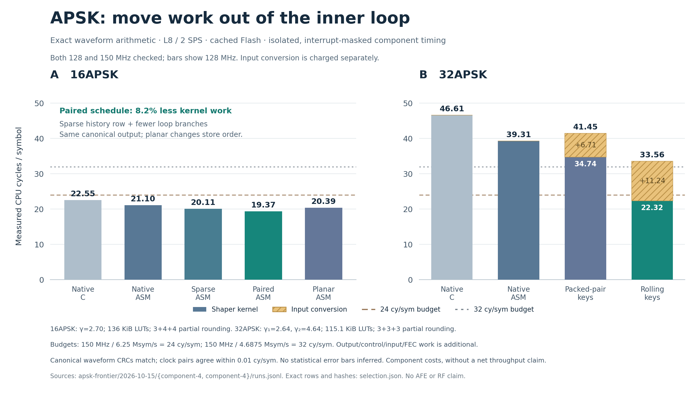

# APSK component experiments, 15 October 2026

The useful results are an **8.2% reduction in exact 16APSK shaper work**, and a
**32APSK rolling-key engine that removes 43.2% of the shaper work**. Charging its
standalone input conversion reduces the latter gain to **14.6%**. Both preserve
their respective native fixed-point waveforms exactly.

These are component experiments on the USB-only RP2350B, at stock voltage and
128/150 MHz. They extend the work in the [waveform campaign](../../waveforms/2026-10-15/README.md).
They do not add complete APSK SPI/FEC/PLFRAME transmission or RF qualification.



## Matched kernel measurements

The final [component repeat](component-4/runs.jsonl) uses the stack-corrected
[build 6](build-6/manifest.json). The 128 and 150 MHz measurements agree within
0.01 cycles/symbol. All modes reproduce the same raw and masked CRCs within
their constellation profile. Tables, pulse coefficients and rounding are fixed
within each comparison; interrupts are masked during these isolated timings.

| 16APSK, L8 / 2 SPS, 136 KiB tables | Cycles/symbol |
|---|---:|
| Native C | 22.5522 |
| Previous native assembly | 21.1036 |
| Omit the zero history contribution | 20.1115 |
| Also process two groups per loop | **19.3693** |
| Planar I/Q stores | 20.3927 |

The old three-coordinate row contributes zero to the fourth output symbol.
Skipping that load and addition is exact. Unrolling two groups reduces loop
overhead. Neither change adds sample RAM or changes the 3+4+4 partial rounding.
The planar layout preserves the samples but changes their store order; it was
slower than the paired interleaved kernel.

| 32APSK, L8 / 2 SPS, 115.15 KiB tables | Shape | Convert | Sum | Input bytes/symbol |
|---|---:|---:|---:|---:|
| Native C | 46.6059 | — | 46.6059 | 2 |
| Native assembly | 39.3089 | — | 39.3089 | 2 |
| Dense pair keys, assembly | 34.7384 | 6.7091 | 41.4475 | 2 |
| Rolling triple keys, assembly | **22.3164** | 11.2437 | **33.5601** | 4 |

Costs are cycles/symbol. Conversion includes chunk-history preparation and
measurement overhead. The dense pair format loses when a separate converter is
charged. A future mapper could emit it directly using small point-contribution
tables, but that mapper has not been integrated. The rolling-key result remains
a useful reduction even with the measured converter included.

## What changes in the 32APSK engine

The native outer-radius-one geometry needs 17 coordinate values per axis,
including zero, signs and unit-radius header/pilot coordinates. A group of three
coordinates has a radix-17 key:

```text
key = a + 17*b + 289*c        # 0..4912
```

I and Q keys fit in separate 16-bit lanes. Their sums never carry between lanes,
so ordinary 32-bit arithmetic computes both axes together. Three tables each
contain 4,913 rows of two packed sample words: **117,912 bytes total**. Together
they cover the eight-symbol FIR history for each two-symbol output group.

The rolling format stores one such triple key per complex symbol. The shaper
then loads only three key words, selecting the old, middle and future rows.
It performs six row lookups, signed lane additions and one output store burst.
The assembly loop shrinks from 62 to 33 instructions per two symbols. Measured
Pico cycles, rather than instruction counts, determine the performance claims.


The output experiment precomputes a cyclic key source. Its runtime measurements
therefore exclude live key production. An 8,192-symbol source occupies 32 KiB;
a whole normal 32APSK data frame would exceed that ring. Live use needs an
incremental mapper/publisher or a different memory allocation.

## Continuous digital output

The interleaved output tests shape with interrupts enabled while actual DMA
feeds PIO. Their four output blocks are published only after completion. Every
positive run checks all **8,192 captured 16-bit bus observations** against an
independent scalar FIR, using one offset in a bounded producer-cursor window.
Both I/Q flags and capture transport CRCs are checked.

The [16APSK soak](output-soak-1/summary.json) and
[32APSK soak](output32-soak-1/summary.json) each run for 60 seconds at both
5.333333 Msym/s / 128 MHz and **6.25 Msym/s / 150 MHz**, with core 1 idle.
The 16APSK shaper uses about 81.0% of core 0's cycle budget at the faster rate;
32APSK uses about 92.3%. These instrumented work fractions exclude outer-loop
spinning and, for 32APSK, key generation. They are not total CPU activity or
power measurements.

Output batches and source placement differ from the isolated component test,
so their cycle measurements should not be interpreted as an isolated DMA cost.
The [short comparisons](output-quick-1/summary.json) also cover both supported
output rates, all three assembly 16APSK schedules, and both clocks. The
[32APSK short runs](output32-quick-1/summary.json) cover both rates and clocks.

The [planar experiment](planar-quick-1/summary.json) uses immutable per-axis
descriptor rings pointing directly at I4/Q4 rows. There are no runtime sample
copies or descriptor writes. It passes exact sparse capture checks at stride 17,
but takes about 20.44 shaper cycles/symbol and more supervision work. It does not
improve on the simpler interleaved path.

The retained [16APSK deadline controls](output-deadline-negative-1/summary.json)
deliberately request an unsustainable 16-cycle/symbol budget. They detect
underruns rather than reporting a passing stream. Their partial-run timing
fields are diagnostic only; they are excluded from performance comparisons.
The 32APSK [slow-kernel control](output32-slow-kernel-negative-1/summary.json)
fails at the same rate sustained by assembly; its
[higher-rate control](output32-rate-negative-1/summary.json) also detects the
deliberately excessive request at both clocks.

## Shared modulation geometry

The same 17-level alphabet also contains native unit-radius QPSK and 8PSK.
[The mixed-mode proof](validation/mixed-modes.txt) checks 360 transitions across
all five fixed 32APSK ring-ratio profiles, odd partial groups, unit pilot geometry
and all four Gold quarter-turns. All 289,960 checked output halfwords match the
continuous scalar reference without clearing history.

This establishes a possible common QPSK/8PSK/32APSK shaping engine. It does not
implement PL signalling, bit-label mapping or complete frame switching. The
existing faster, globally π/8-rotated 8PSK engine is a different representation.
16APSK is also a separate table alphabet.

The chosen amplitude policy is the outer-radius-one option in
[ETSI EN 302 307-1, §§5.4.3–5.4.4](https://www.etsi.org/deliver/etsi_en/302300_302399/30230701/01.04.01_60/en_30230701v010401p.pdf).
For the 32APSK 5/6 geometry, γ₁=2.64 and γ₂=4.64; mean data-symbol energy is
0.62720162, while unit-radius pilots are 2.026 dB above that mean. The fixture is
in geometric ring/angle order, not a claimed DVB-S2 bit-label mapper.

## Validation and provenance

An independent stack audit found that the first 32APSK builder's 1,272-byte
temporary could exceed the 2 KiB stack through the command handler. Recomputing
its rounded products during table construction reduces the frame to **176
bytes**. All 147,390 table words across five ratios remain identical. Static
main+component+builder usage is now 1,000 bytes; main+output+builder is 912 bytes,
leaving roughly 1 KiB for other calls and interrupts. These are compiler reports,
not measured stack high-water marks.

Builds 2/3 and their initial 32APSK observations remain exploratory records.
**Final 32APSK evidence uses build 6 and component repeat 4.** Each build manifest
binds the frozen firmware sources and ELF/UF2 hashes; flash logs record verified
loads. Binary images remain local and ignored by Git. The shared dirty git label
alone cannot identify these images; use their SHA manifests.

The [validation summary](validation/summary.json) links the full `make check`
log, native/actual-source ISA checks, negative capture controls, exact table
equivalence and compiler stack reports. All final firmware source hashes match
the build-6 snapshot. Both firmware targets build without warnings. No default
flight waveform or complete-transmitter qualification is changed by these lab
commands.

```sh
# Build/flash first. GPIOs must match the intended lab setup.
python3 host/iq16out_trial.py --kernels 1 3 --cpw 6 --ms 60000 \
  --build firmware/build --out results/apsk-local/16
python3 host/iq32out_trial.py --kernels 1 --cpw 6 --ms 60000 \
  --build firmware/build --out results/apsk-local/32
python3 host/plot_apsk_frontier.py
```

The next substantial experiment is fusing rolling-key production into a
streaming mapper, then measuring its combined work and ring ownership. That
would establish whether the 32APSK output gain survives actual frame production.
