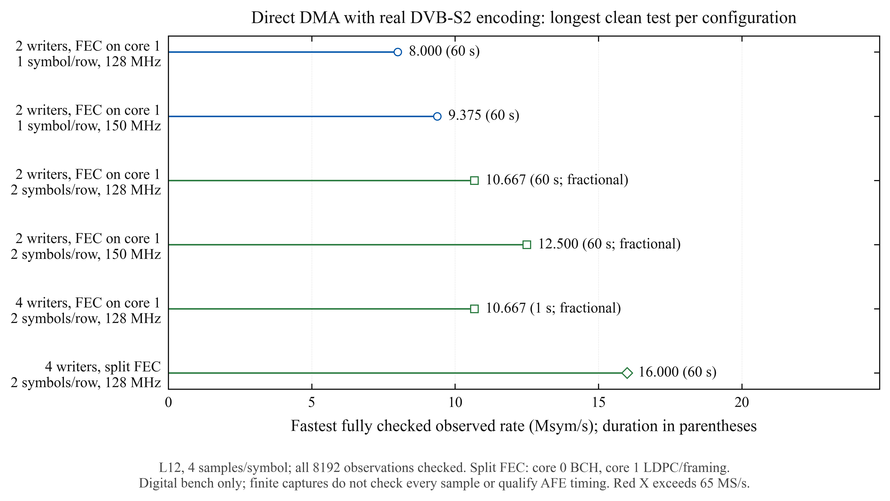
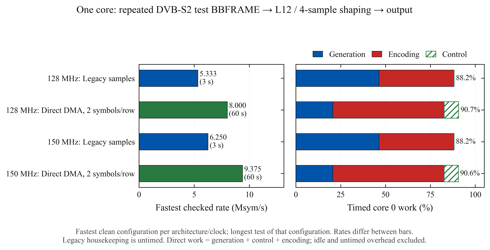

# Direct LUT DMA experiments, 2026-10-14–15

This campaign benchmarks the current CPU sample-copy shaper against direct LUT reads by DMA,
using two alternating PIO writers, two-symbol rows, and an optional four-writer schedule.
It runs on the USB-only Pimoroni Pico Plus 2 / RP2350B, stock voltage, at 128 and 150 MHz.
All external GPIOs are disconnected. These are digital experiments; no DAC or RF receiver
has verified the output, and the normal transmitter startup profile remains unchanged.

## Final frozen-build measurements

The [qualification log](qualify-1/runs.jsonl) contains ten 60-second positive streams,
four cause-specific negative controls, and legacy/CRC checks before and after each clock.
Every positive stream had zero reported faults and all 8,192 captured bus observations exact.
All rows use QPSK 2/3 with pilots, L12, 4 SPS, interpolator pointer generation and stock voltage.

| Mode | Clock | PIO writers | Symbols/row | Rate (Msym/s) | Core 0 timed work | Core 1 timed work | Duration |
|---|---:|---:|---:|---:|---:|---:|---:|
| FEC on core 1 | 128 MHz | 2 | 1 | 8.000 | 51.94% | 63.47% | 60 s |
| FEC on core 1 | 128 MHz | 2 | 2 | 8.000 | 39.32% | 62.98% | 60 s |
| FEC on core 1 | 128 MHz | 2 | 2 | 10.667 | 47.28% | 85.31% | 60 s |
| One core | 128 MHz | 2 | 2 | 8.000 | 90.74% | idle | 60 s |
| Live shaper | 128 MHz | 4 | 2 | 16.000 | 66.25% | idle | 60 s |
| Split FEC | 128 MHz | 4 | 2 | 16.000 | 97.56% | 91.91% | 60 s |
| FEC on core 1 | 150 MHz | 2 | 1 | 9.375 | 51.06% | 63.46% | 60 s |
| FEC on core 1 | 150 MHz | 2 | 2 | 9.375 | 38.19% | 62.96% | 60 s |
| FEC on core 1 | 150 MHz | 2 | 2 | 12.500 | 46.32% | 85.30% | 60 s |
| One core | 150 MHz | 2 | 2 | 9.375 | 90.58% | idle | 60 s |

At 8 Msym/s/128 MHz, the matched legacy shaper measured 77.0% generation work.
The paired direct-DMA path measured 23.73% generation plus 15.59% monitored control,
39.32% total: about 49% less instrumented work than the legacy generation-only figure.
Legacy housekeeping was not timed; this is not a whole-core idle measurement.

The matched legacy one-core encoder/shaper passed 5.333 Msym/s at 128 MHz and 6.250 at 150 MHz
for 3 seconds, at 88.2% generation+encoding work. The direct-DMA one-core path passed 8.000
and 9.375 respectively for 60 seconds, at 90.74%/90.58% including monitored control.

The 16 Msym/s split-FEC run completed 28,846 backend frames and 28,844 runtime BCH frontends.
Core 0 measured 97.56% work and core 1 measured 91.91%. Its maximum frontend slice was
14,608 cycles (114.1 µs), versus 106,240 cycles for a complete frontend. Minimum published
descriptor lead was 12,444 symbols. This has little reserve and is not a recommended flight
operating point. It does demonstrate twice the default 8 Msym/s digital rate at the same 128 MHz. The
[second independent 60-second 16 Msym/s run](repeat-16-1/runs.jsonl) also passed, at the same
97.56%/91.91% work ratios, zero faults and 8,192 further exact bus observations. These were
two separate runs, not one continuous 120-second run. Reproduce that repeat with
`python3 results/dual-dma/2026-10-14/repeat-16-1/reproduce.py /tmp/yapogee-repeat16` using a
fresh output directory.

At QPSK 2/3 with pilots, the BB-data capacity after the 80-bit BBHEADER is
`(43040-80)/33282 * symbol_rate`: about 10.33 Mb/s at 8 Msym/s and 20.65 Mb/s at 16 Msym/s.
That is a framing-capacity calculation; live SPI ingress and TS/application overhead were
not measured in these new modes. Fractional10.667/12.5 results still need external timing
qualification; the 16 Msym/s result uses an integer divider.






## Architecture

The original shaper already uses separable L12 I/Q LUTs and a pipelined assembly kernel.
A joint L12 QPSK table is unnecessary: independent I/Q state machines alternate writes to
the same bus, each fed by its own LUT-gather DMA chain. A control DMA writes a row pointer
to a sample DMA's AL3_READ_ADDR_TRIG. That sample DMA sends the axis row, paced by its own
PIO TX DREQ, then chains back to the control DMA. Pointer generation and publication still
use CPU time; this is not a zero-CPU transmitter.

The first version sends two 32-bit words per axis lookup: one four-SPS symbol. The paired
version combines two consecutive histories in a 13-bit key, sharing one unflagged 128-KiB
table between I and Q. Each row is four words, containing exactly the original two waveform
rows. Optional PIO side-set supplies the I/Q flag on OUT only. This halves pointer writes
and control handoffs while preserving every quantized sample of the existing L12 filter.

C, unrolled Thumb-2, and RP2350 interpolator pointer generators are independently checked.
The interpolator version borrows and restores both interpolators on the producing CPU,
with interrupts disabled for that bounded generation block. It uses one POP per pointer;
it does not depend on DMA reading side-effecting interpolator registers.

The paired table borrows the existing 128-KiB sample ring. The two aligned input rings hold
8192 descriptors per axis, and the capture buffer holds the packed input plus capture.
There is no new permanent table allocation. Baseline PRBS input is restored after the test.
The one-symbol version retains the original separate 32-KiB tables and uses the old sample
ring for descriptors. Hardware descriptor wrap is limited to 32 KiB per ring.

Four writers, when selected, alternate even and odd paired rows on each axis. Each writer
has a distinct PIO TX DREQ and its own control/data DMA pair. It doubles available TX FIFO
buffering without changing the aggregate sample traffic. The original transmitter retains
its PIO0 claims between runs, so the four-writer trial uses PIO2 and captures on PIO1.
This placement competes with the existing PV-SPI allocation and is not an integrated SPI
transmitter profile.

At any output stall, the engine stops all writers together. It preserves sticky DMA/PIO
faults, validates generation ownership, checks descriptor-wrap polling deadlines, and
latches final counters before DMA abort clears TRANS_COUNT. Four-writer reuse uses the
earliest chronological unissued row; publication deadlines use the highest issued row.
Claims, GPIO state, HSTX state and temporary bus priorities are released/restored on exit.

## Encoder scheduling

Source 4 pipelines BB scrambling/BCH on core 0 with LDPC/mapping on core 1. Two FE buffers
remain separately owned through mapping; the second 8,108-byte buffer fits the existing 8-KiB
capture-buffer tail. Release/acquire barriers publish complete frontend work, preserve the
backend's output ring reservation and protect reuse. The existing encoder wrappers keep
their original single-buffer behavior.

A whole BCH pass was too long for reliable descriptor refills at 16 Msym/s. The optional
frontend now processes at most 128 complete input words per step, preserving the five-word
BCH state between calls. The assembly continuation shares the original streamed recurrence;
unsupported degrees/selectors retain the full-frame fallback. Descriptors refill between
steps. Source 4 uses 2048-symbol descriptor blocks to reduce control overhead, two encoded
startup frames and two prepared frontend slots; only runtime work enters its timed counters.
Its alternating inputs flip the MSB of every 64th BB word, so the reference contains two
distinct frame phases rather than one repeated encoded pattern.

## What the measurements mean

`gen_busy` measures pointer-generation calls. `control_busy` measures monitored progress,
ownership, capture and fault checks. `core0_work_busy` sums those spans; in source 3 it also
includes staged encoding on core 0. These are instrumented work ratios, excluding idle
spin waits, untimed outer-loop work and interrupts outside timed regions. They are not
whole-core idle-time measurements. Legacy `core[0].busy` times generation only and excludes
its housekeeping, so a lower new generation-plus-control result is a conservative compute
saving relative to that baseline metric. Code placement changes the measured legacy cost;
matched firmware builds are used for final comparisons.

Source 2 freshly encodes repeated BBFRAME data on core 1 during the measured interval.
Source 3 runs BB scrambling/BCH, LDPC and PL framing as cooperative stages on core 0, refilling
descriptors between stages; core 1 remains idle. Neither is a replay of stored encoded I/Q.
Source 4 instead distributes the same stages across both CPUs with bounded frontend slices.
These sources do not include TS packet construction, a real camera or PV-SPI ingress.
Source 1 is live PRBS pointer generation; source 0 precomputes a cyclic descriptor pattern.

## Validation and limitations

Native tests compare chronological symbol histories and descriptor-resolved waveforms
against the independent Python reference, including block transitions and uint32 address
wrap. The shared paired table is checked across all 8,192 rows against quantized integer
FIR calculations. Two-buffer encoder tests interleave three varied frames in all 42 code/pilot configurations
and three BCH selections, comparing continuous output/partial words against independent
Python. Incremental160-bit BCH tests use chunk sizes1/7/128/511 and bit-serial parity,
including tail bytes, unsupported-mode preservation and two live frontend states.
The PIO model decodes the actual instruction arrays and checks 65,536 bus slots,
row ordering, 4,096 progress combinations and ring wraps. Native tests execute the portable recurrence; normal2/3 board captures exercise the Thumb-2
continuation. Firmware builds include both iqbench and pvflight.

Ordinary positive captures check all 8,192 observed 16-bit bus values, with a serial CRC and
strict capture ordering. One fixed reference offset and one hardware-time phase must fit
the entire snapshot. Integer clocks use stride17 bus slots. At divider1.5 the capture SM
instead runs at SYSCLK, so expected indices are offset+floor((34*j+phase)/3), phase0..2;
both I and Q must be observed. This avoids the old sampler alias that saw only I.
These are finite sparse snapshots, not checks of every outgoing sample.

Captures of at most 8 packed words can use only the PIO RX FIFO: it fills and parks, and the
CPU drains it after output stops. This avoids adding capture-DMA contention but checks only
16 bus observations per8-word snapshot. Such results must be identified separately from
8192-observation captures. Deliberately wrong valid Q pointers must fail waveform matching;
deliberately starved publication must trip ownership/underrun checks. Configuration errors,
missing serial data and aborted captures do not qualify as successful negative controls.

The HSTX clock on GPIO16 is a single-ended DDR-clock candidate. AFE7071 DDR requires its
DACCLKP/N differential input; CLK_IO is SDR. Pad timing, differential conversion, clock/data
phase, setup/hold, jitter, analog reconstruction and RF performance remain unmeasured.
Fractional1.5 produces alternating one/two-SYSCLK data-slot spacing; a digital reference
match does not qualify its external DAC timing. At 4 SPS,16 Msym/s means64 MS/s per I/Q DAC;
18.75 Msym/s would mean75 MS/s and exceed the AFE7071's65 MS/s rating.

The final qualification uses code commit `79d1e8505610221bdf61539b650ca8357b17a63a`.
The [flashed UF2](qualify-1/iqbench.uf2) is archived with SHA256
`d823bb6782da47e992e5a4f12399daf1b46da8993f0103c5f1201b6ea23dbb3c` and
[picotool verification metadata](qualify-1/flashed-firmware.json). Firmware, runner and
reference hashes stayed fixed through qualification; the independent plotting script was
updated afterward. Its selected source records are saved in
[dual_dma_selection.json](../../plots/dual_dma_selection.json).

## Reproduce

Build and flash iqbench from this branch; the runner deliberately does neither:

```sh
ninja -C firmware/build-limits
picotool load -v -f firmware/build-limits/iqbench.uf2 -x
python3 host/test_iqdesc.py
python3 host/test_iqpair.py
python3 host/test_dual_pio.py
python3 host/dual_trial.py --self-test
python3 host/dual_trial.py quick --row-symbols 2 --out /tmp/yapogee-dual-quick
python3 host/dual_trial.py qualify --row-symbols 2 --out /tmp/yapogee-dual-qualify
python3 host/plot_dual.py --root results/dual-dma/2026-10-14
```

Each output directory is immutable. Manifests record source/reference/ELF/UF2 SHA256,
Git state and test configuration; raw captures and every failed ceiling probe are retained.
Use a fresh output path for each run. Commands are opt-in:

```text
dualbench [reps]
dualwriters 2|4
dualprio mask                    #0..15 register-field nibble; default 0
dualstream cpw ms kernel source cap_words fault [schedule] [divider256] [row_symbols]
```

Kernel0/1/2 selects C/assembly/interpolator; source 0/1/2/3 selects precomputed/livePRBS/
core1FEC/core0stagedFEC; source 4 selects pipelined core0BCH+core1LDPC/map. Row_symbols1/2 selects original/paired rows; four writers require
paired rows. Schedule0 is all high-priority DMA channels,1 is control-high/data-low,
2 is data-high/control-low,3 changes channel claim ordering. Optional divider256=384
selects1.5 clocks per bus slot; otherwise cpw1..4 applies. Fault0/1/2 means none/wrongQ/
stop publication. Runs restore clock128 MHz, BCHkernel0, writer count2 and priority mask0.

Bus-priority masks select register labels PROC0/PROC1/DMA_R/DMA_W in nibble bits 0/1/2/3.
[RP2350-E27](https://datasheets.raspberrypi.com/rp2350/rp2350-datasheet.pdf#page=1357)
changes their meaning at the peripheral ports: a generic 'DMA high priority' setting is
not uniform across SRAM and FASTPERI. The experiments save and restore the previous register.
Timer-paced pointer triggers are intentionally avoided: triggering while busy is not a
safe row queue, and two DMA channels must not share a PIO DREQ.

## Retained failed probes

All failed probes remain in their original logs. Early one-symbol rows starved even with
precomputed pointers at 16 Msym/s, exposing handoff latency independently of CPU generation.
Paired two-writer rows improved CPU work and sustained the intermediate clock, while 16 Msym/s
remained sensitive to capture DMA and encoder contention. Four writers supplied enough FIFO
buffering to pass the ordinary 8192-observation live-shaper check at 16 Msym/s.

`quick-1` contains an invalid first negative control: an old harness requested fault1 with
precomputed source 0, which firmware rejected. Its old 'detected' classification is not
accepted as waveform-negative evidence. Later negative controls require the injected cause.
`priority-1` has a manifest only: the USB CDC port had not re-enumerated, and no hardware run
occurred. `four-quick-1` exercised resource rejection, because the legacy baseline retained
PIO0 claims; it is not a throughput measurement. The later PIO2 version fixes that conflict.
`paired-quick-1` fractional captures saw only I through a sampler-phase alias and are excluded;
`paired-quick-2` uses the corrected independent sampler and checks both axes.

`split-quick-1` had insufficient encoded startup lead at 16 Msym/s. Two encoded prefills let
`split-quick-2` run18 frames before the whole BCH slice caused a deadline miss. The chunked
frontend removes that long slice; its measured results and remaining utilization limits are
reported separately. Older source 4 variants flipped only the first BB bit; final records
explicitly report `split_bb_stride_words=64` and `split_bch_slice_words=128`.
