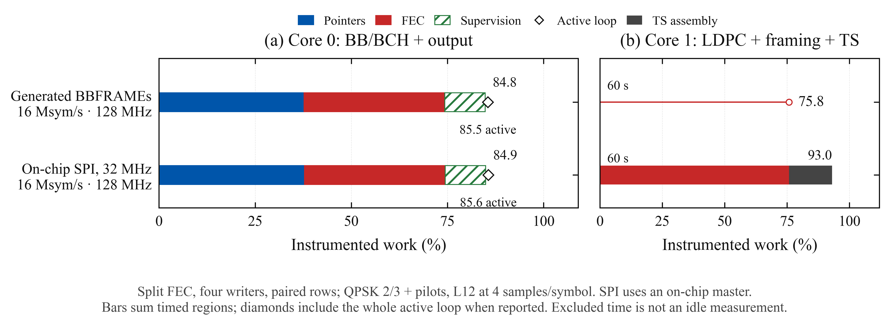

# 16 Msym/s headroom and SPI ingress

The previous 16 Msym/s split encoder used 97.56% of core 0 and 91.91% of core 1 in timed
regions, leaving little room for payload input. This pass reduces that work, adds an actual
PIO/DMA SPI ingress test, and makes the experimental code easier to review.

The broad non-SPI matrix and original encoder timings used **`8373e88662`**. The SPI
completion fix was qualified at **`c6714d76ab`**. Final image **`503bce5fd6`** adds fresh
legacy capture startup; its separate checks are recorded below. These revisions remain
distinct so the later fixes do not retroactively qualify earlier failures.

The images were built with Pico SDK 2.2.0 / GCC 14.2 for a Pimoroni Pico Plus 2, RP2350B
rev A2. All tests used stock voltage and USB only, with external GPIO connections removed.
Each preserved UF2 was loaded with picotool's verification enabled. Documentation and plot
presentation were updated after the firmware freezes.

## Measured results

All encoder configurations use normal QPSK 2/3 with pilots. Every row uses L = 12,
RRC α = 0.20 and 4 samples/symbol; the shaper-only row uses a PRBS symbol stream.
Each qualifying stream run lasts 60 seconds and checks all 8192 bus observations in its
4096-word sparse snapshot against an independent reference, without dropping mismatches.
Continuous hardware flags and descriptor-generation checks monitor stalls and buffer deadlines.
The snapshot does not inspect every sample sent during the run.

The following non-SPI runs passed all their checks for 60 seconds on `8373e88662`.
Their raw measurements are in [`qualify-1/runs.jsonl`](qualify-1/runs.jsonl).

| Mode | Clock | Rate (Msym/s) | Core 0 work | Core 0 active | Core 1 work |
|---|---:|---:|---:|---:|---:|
| One-symbol rows, FEC on core 1, two writers | 128 MHz | 8.000 | 47.93% | 48.67% | 55.94% |
| Paired rows, FEC on core 1, two writers | 128 MHz | 8.000 | 34.73% | 35.56% | 58.33% |
| Paired rows, FEC on core 1, two writers | 128 MHz | 10.667 | 44.17% | 45.06% | 79.56% |
| Paired rows, one core, two writers | 128 MHz | 8.000 | 80.34% | 80.92% | Unused |
| Paired rows, shaper only, four writers | 128 MHz | 16.000 | 54.90% | 55.81% | Unused |
| Paired rows, split FEC, four writers | 128 MHz | 16.000 | 84.78% | 85.48% | 75.76% |
| One-symbol rows, FEC on core 1, two writers | 150 MHz | 9.375 | 47.14% | 47.82% | 55.91% |
| Paired rows, FEC on core 1, two writers | 150 MHz | 9.375 | 33.71% | 34.48% | 58.29% |
| Paired rows, FEC on core 1, two writers | 150 MHz | 12.500 | 43.42% | 44.24% | 79.56% |
| Paired rows, one core, two writers | 150 MHz | 9.375 | 80.08% | 80.63% | Unused |

The 16 Msym/s split-FEC row above has no SPI input. At 16 Msym/s, four samples/symbol
corresponds to 64 MS/s per axis; the digital rate remains separate from electrical or RF
qualification. SPI results and their separate image provenance appear below.

“Core 0 work” sums descriptor generation, supervision and any encoding assigned to that core.
“Core 0 active” covers the whole active loop, including surrounding bookkeeping. Intentional
idle polling is excluded. Core 1's SPI figure includes both its encoding and TS construction.
These ratios describe instrumented work; neither CPU enters an idle sleep state.



The SPI source is an on-chip master driving GP17–19 at 32 MHz. A separate PIO receiver,
DMA transfer, CS interrupt, READY flow control, message parser and TS builder all run during
transmission. It exercises the receive path and scheduling, but shares the chip's clocks.
The earlier external CM5 runs remain evidence for 8 Msym/s, rather than for this new rate.

## Where the margin came from

- **Separate SRAM for tight loops.** The paired descriptor loop moved to scratch Y, alongside
  the small BCH leaf. LDPC transpose and mapping leaves use scratch X. This avoids instruction
  fetch contention with sample/descriptor traffic in striped SRAM. The `8373e88662` map leaves
  404 bytes between scratch-X code and the core-1 stack, and 1376 bytes before the core-0
  stack in scratch Y. The stacks retain their 2-KiB allocations.
- **Cheaper supervision.** Cached channel masks and one raw DMA interrupt read replace eight
  healthy-path channel-control reads. All owned channels use `IRQ_QUIET`, making an unexpected
  raw interrupt fatal. Completed captures are latched once. Fault monitoring, cursor wrap
  bounds, publication deadlines and final post-abort AHB checks remain in place.
- **Less FEC memory traffic.** A tiled 32×32 transpose reduces matrix loads/stores from 160
  each to 64 each. Normal 2/3 parity is packed with straight stores in existing workspace;
  word-aligned parity goes directly into its frame destination. A byte-gather table reuses
  the PL-scrambling initialization workspace, and a compact mapping leaf retains stream state
  in registers. No additional permanent FEC SRAM is allocated.
- **Balanced TS work.** Core 1 keeps two BBFRAME slots prepared before running the LDPC/map
  backend. Core 0 copies a complete BBFRAME into a free FEC slot, releases the BB slot, and
  computes BCH in bounded 128-word chunks. Early BB preparation prevents queue bubbles.
  Both queues publish complete data with memory barriers before releasing ownership.

The isolated encoder benchmark also improved. Both columns below use normal QPSK 2/3,
pilots, 128 MHz and streamed BCH selector 2. The before point is the earlier
[`fec-k2-code5` development record](../../limits/2026-10-14/quick-2/runs.jsonl), tagged
`741defe613-dirty`, with eight repetitions. The after point is the frozen
[`device-checks-2` record](device-checks-2/fec.jsonl), with four repetitions. This is a
cross-build comparison of the combined changes, not a same-build toggle of one optimization.

| Encoder region | Before (cycles/frame) | Frozen `8373e88662` | Change |
|---|---:|---:|---:|
| BB scrambling + BCH | 91,907 | 91,910 | Approximately unchanged |
| LDPC + parity append | 130,094 | 106,978 | −17.77% |
| QPSK mapping + PL framing | 103,619 | 90,218 | −12.93% |
| Complete frame | 325,678 | 289,166 | −11.21% |

The three regions are firmware profiling intervals; the complete-frame total also includes
call/checkpoint overhead. The standalone BCH measurement remained about 80,800 cycles.
The complete output CRC was `759869660` in both records. Integrated streaming loads in the
table above include concurrent DMA traffic and supervision, so they should not be inferred
directly from these isolated frame timings.

These improvements build on the previous campaign's architectural changes: paired LUT rows,
four staggered PIO writers and independent FIFOs, and split frontend/backend encoding. A sample
DMA transfer reads four 32-bit words from one immutable paired row. Its control DMA reads just
one pointer and writes the sample channel's `AL3_READ_ADDR_TRIG` register. The CPU produces
pointers and supervises the rings; it does not copy the outgoing samples.

## Code cleanup

The bench now names its source modes and layout constants, separates setup/prefill from the
streaming loop, and keeps slot publication explicit. PV-SPI accepts a PIO instance and releases
its programs, state machines, DMA channels and interrupt handler on stop. This allows its three
self-test machines to share PIO1 with the capture machine, while PIO2 owns the four writers.
The high-rate SPI trial rejects unavailable resources before starting and reports a failed
startup prefill explicitly.

The three encoder assembly leaves are in
[`dvbs2_asm.S`](../../../firmware/src/dvbs2_asm.S), with normal assembler syntax and portable C
fallbacks in `dvbs2.c`. Extraction preserved every instruction byte: 260 bytes of BCH code,
308 of transpose and 160 of mapping. The autonomous startup profile is still 8 Msym/s;
this campaign does not switch that default to the experimental interface.

The legacy recorder now stays disabled until capture is requested. Capture startup disables
and clears the sampler, resets its ISR/shift counters and instruction delay, forces the first
IN instruction, arms DMA, then enables sampling. Output keeps running throughout. With the
integer system-clock sampling used here, the later enable changes a constant reference offset
rather than the sample spacing. All 4096 captured words are retained (`cap_skip=0`); the
previous eight-word stale-FIFO discard is removed. This addresses the stale-FIFO/live-data
handoff without asserting a unique cause for the original intermittent failure.

The SPI fix waits for both a zero DMA transfer count and a cleared `BUSY` flag before reading
the sniffer CRC or reusing a queue slot. A CS rising edge, or a count of zero by itself, does
not establish that every in-flight transfer has retired; see
[RP2350 DMA section 12.6.8.3](https://pip-assets.raspberrypi.com/categories/1214-rp2350/documents/RP-008373-DS-2-rp2350-datasheet.pdf?disposition=inline).
The close path allows a bounded 3 µs drain, withdraws READY under its lock, rejects DMA
errors and observed late CS assertions, and reports deferred completions, timeouts and short-message
snapshots. Resetting the receiver still discards partial trailing bits for alignment; it does
not add exact rejection of every possible 1–31-bit overlength transfer.

## Validation and provenance

- [`qualify-1`](qualify-1/runs.jsonl), image `8373e88662`: matched sample-buffer/direct-DMA comparisons, both
  clocks, one-core operation, the 16 Msym/s split encoder, and wrong-Q/starvation controls.
- [`device-checks-2/fec.jsonl`](device-checks-2/fec.jsonl): all 21 QPSK codes, with and without
  pilots, passed on image `8373e88662` against the independent Python PLFRAME reference.
- [`device-checks-3/fec.jsonl`](device-checks-3/fec.jsonl): all 42 configurations also passed
  on final image `503bce5fd6`. Its [pointer component check](device-checks-3/pointers.json)
  completed 32 repetitions with exact address CRCs, zero mismatches, TX stalls or AHB errors;
  the [manifest](device-checks-3/manifest.json) records the source and image hashes.
- [`device-checks-2/pointers.json`](device-checks-2/pointers.json): the separate PIO lookup-address
  experiment, checked independently by the host as well as by firmware.
- [`qualify-1/manifest.json`](qualify-1/manifest.json) records source, model, runner and binary
  hashes. [`flashed-firmware.json`](qualify-1/flashed-firmware.json) identifies the verified
  image and board. The [UF2](qualify-1/iqbench.uf2) is preserved with those records.
- `make check` passes the native encoder/protocol suites, all 42 frame configurations with
  varied inputs and continuous streams, matrix-basis and parity-canary checks, PIO instruction
  models, DMA fault snapshots, and SPI/reference corruption controls. It does not access USB.
- [`host/test_pvspi_rx.py`](../../../host/test_pvspi_rx.py) extracts the actual close/IRQ/arming
  functions into an event-driven native fixture. It checks all 333 nonzero remaining-word
  counts, delayed DMA retirement, count-zero/still-BUSY, extra FIFO words, AHB errors, late CS,
  timeout wraparound, bad CRC and paused READY behavior. This validates software decisions,
  not PIO timing or the unique cause of the observed failure.

## SPI completion and qualification

The final capture-startup image is commit
`503bce5fd6656f942e7d63a87f6efb712edc4518`, with [preserved UF2](final-1/iqbench.uf2)
SHA-256 `d0aa947ab492353887e7010010a51ab1b7ca348153b3cf033ba200d8a1357ef4`.
The [manifest](final-1/manifest.json), [verified flash record](final-1/flashed-firmware.json)
and [flash log](final-1/picotool-flash.txt) identify that image. All 37 recorded firmware
source/CMake hashes match the commit; the `503bce5fd6-dirty` runtime suffix records the
uncommitted documentation, plotting and result files.

The [final-image campaign](final-1/runs.jsonl) passed separate 60-second SPI runs at 8 and
16 Msym/s, at 128 MHz with a 32 MHz on-chip source. Both had matching ingress and BBFRAME
CRCs, no null insertion and zero short/long messages, loss, deferred closes, drain timeouts,
late closes, output underruns, ownership errors or TX stalls. All 8192 bus observations in
each sparse snapshot were exact. Legacy shaper/encoder baselines before and after the runs
also passed with fresh 4096-word captures, and wrong-Q/starvation controls were detected.

| Final `503bce5fd6` rate (Msym/s) | Core 0 work | Core 0 active | Core 1 work | Accepted messages | Duration |
|---|---:|---:|---:|---:|---:|
| 8.000 | 48.30% | 49.04% | 46.09% | 58,883 | 60 s |
| 16.000 | 84.91% | 85.62% | 93.03% | 117,728 | 60 s |

At 16 Msym/s, core 1's total is 75.79% backend encoding + 17.24% TS construction.
The corresponding final image passed all 42 independent device encoder CRC checks and the
32-repetition pointer component test described above. These checks do not repeat the entire
earlier non-SPI throughput matrix on the new image.

The fresh-capture [development trial](development-capture-fresh-1/runs.jsonl) retained all
8192 bus observations with zero mismatches for five 3-second legacy PV-SPI restarts. Six
additional 1-second PRBS streams checked `lut_asm` and `lut_asm_p` at cpw=2, plus
`lut_asm_p` at odd cpw=3, at both 128 and 150 MHz. Those also checked all 8192 observations
with zero output faults. All used the paired-word layout; the raw PV-SPI captures,
[source/binary manifest](development-capture-fresh-1/manifest.json) and
[development UF2](development-capture-fresh-1/iqbench.uf2) are preserved. These development
passes support the recorder change, while final-image evidence is listed separately.
Four further [packed-layout checks](packed-capture-1/runs.jsonl) used the final image's
`lut_win` path at cpw=8 and odd cpw=9, at both 128 and 150 MHz, for one second each.
Every run retained all 4096 words (`cap_skip=0`), checked all 8192 bus observations with
zero mismatches and reported no output faults. This separately covers the packed-word
writer rather than treating the paired-kernel trials as packed coverage.

Image `c6714d76abe0b0d95ec58ba167fe34d79927c468` passed separate 60-second SPI runs
at 8 and 16 Msym/s, at 128 MHz with a 32 MHz on-chip SPI source. Both runs had zero
short/long messages, lost messages, null insertion, drain timeouts, late closes, output
underruns, ownership errors or TX stalls. Their ingress CRC chains and first-four BBFRAME
CRCs matched the reference, and all 8192 bus observations in each snapshot were exact.
The [final run log](spi-2/runs.jsonl) also includes passing legacy checks and detected
wrong-Q/starvation controls, followed by configuration restoration.

| Rate (Msym/s) | Core 0 work | Core 0 active | Core 1 work | Accepted messages | Deferred closes | Duration |
|---|---:|---:|---:|---:|---:|---:|
| 8.000 | 48.31% | 49.05% | 46.09% | 58,883 | 0 | 60 s |
| 16.000 | 84.91% | 85.62% | 93.03% | 117,732 | 0 | 60 s |

The fixed image's [UF2](spi-2/iqbench.uf2) has SHA-256
`5d20a410f1cb537cd2d64a30c19ae256094da4038d3c86b71c29a6b00575c991`.
Its [manifest](spi-2/manifest.json), [verified flash record](spi-2/flashed-firmware.json) and
[picotool output](spi-2/picotool-flash.txt) identify the source, image and board.
The runtime revision string is `c6714d76ab-dirty`: the manifest records documentation,
plotting and result changes in the working tree, while all 37 recorded firmware source/CMake
hashes match that commit. The earlier full `8373e88662` non-SPI matrix and 42 device
encoder checks remain separate evidence; the following repeat runs cover selected paths.

The [cross-mode regression sequence](regression-2/runs.jsonl) then passed three further
60-second runs on the same `c6714d76ab` image, all at 128 MHz. Each had zero reported I/O faults
and all 8192 captured bus observations exact. The SPI repeat accepted 117,728 messages with
matching ingress CRCs, no null insertion and zero short/long messages, loss, deferred closes,
drain timeouts or late closes.

| Repeat mode | Rate (Msym/s) | Core 0 work | Core 0 active | Core 1 work |
|---|---:|---:|---:|---:|
| One core, no SPI | 8.000 | 80.34% | 80.93% | Unused |
| Split FEC, no SPI | 16.000 | 84.79% | 85.49% | 75.77% |
| Split FEC + on-chip SPI | 16.000 | 84.92% | 85.62% | 93.03% |

**The regression sequence as a whole failed.** Before those long runs, it performed two
3-second legacy PV-SPI restarts. The first capture matched; the second reported
`capture not aligned` over 8176 bus observations (`cap_crc=1742267376`). All reported legacy
output/SPI fault counters and ingress CRCs were clean, but that does not override the failed
waveform check. The [failed JSON record](regression-2/runs.jsonl) is retained; the driver did
not save the raw capture lines for that legacy run. Follow-up
[raw legacy captures](legacy-capture-1/) and the fresh-recorder trial are preserved separately.
The original failure's unique cause remains unproven, and this earlier sequence remains a
failed regression even after subsequent recorder checks pass.

Before the SPI-completion freeze, the
[`development-spi-drain-1` diagnostic image](development-spi-drain-1/runs.jsonl), tagged
`8373e88662-dirty`, passed separate 60-second runs at 8 and 16 Msym/s. At 16 Msym/s it
observed one deferred completion, zero shorts, lost messages, drain timeouts or late closes,
matching ingress CRCs and all 8192 captured bus observations exact. This supports a terminal
receive/DMA latency explanation; it does not uniquely prove which final hardware operation
was delayed. Development success remains separate from final-image qualification.

The earlier frozen
[`spi-1` campaign](spi-1/runs.jsonl) used image `8373e88662`, with UF2 SHA-256
`2f239935a8595a483d00266dee2f68e22d7aea3c7d7424d5c55ea987a1c57c67`. It passed at
8 Msym/s for 60 seconds: 58,883 accepted messages, zero reported ingress/output faults,
matching ingress CRC chain, zero null insertion and all 8192 captured bus observations exact.

At 16 Msym/s it ran for 60,000,086 µs with zero output underruns, ownership errors, TX stalls
or waveform mismatches in the 8192-observation snapshot. However, PV-SPI reported one short
message and one lost message across 117,732 accepted messages, and the accepted-message CRC
chain differed from the pattern source. The host therefore classified the run as **failed**.
See the [raw run log](spi-1/runs.jsonl), [manifest](spi-1/manifest.json) and
[16 Msym/s capture](spi-1/captures/dual-row2-128000-src5-k2-cpw1-fault0-writers4.txt).
The clean waveform snapshot did not establish lossless ingress over the whole run. This
failed `8373e88662` result is retained alongside the diagnostic and final-image records.

For SPI captures, the host constructs a small window of consecutive reference PLFRAMEs near
the reported capture cursor. A preceding frame supplies FIR history; matching is bounded to
that finite window. First-four BBFRAME CRCs, the CRC chain over every accepted SPI message,
zero null insertion, and runtime receive/BB counters check that the test actually consumes
input while running. Configuration failures and short captures cannot pass fault controls.

## Experiments retained, including failures

The [development records](development-probes/) are exploratory evidence, with development
firmware tags rather than final source attestation. Repeating the old image under a different
command sequence exposed stalls around capture startup; those failures are retained rather
than erased by the earlier successful soaks. The frozen campaign must pass its own checks.

A slicing-by-four CRC-8 trial was slower: 1006 versus 803 cycles for 187 bytes, and 39936 versus
31986 cycles in the packet-construction microbenchmark. It was discarded. Putting TS
construction on core 0 missed a descriptor deadline; moving it to core 1 but refilling BB slots
only after running out of FEC work also missed deadlines. Preparing BB slots early removed
that pipeline bubble. The earlier [development SPI soak](development-spi-1/runs.jsonl) passed
with about 99% core-1 work before the final mapping improvement.

## Next architectural experiment

The [research notes](research.md) describe a pin-free PIO program that generates LUT addresses
itself. Four machines produced exact addresses at an equivalent component rate above 35 Msym/s.
This could remove much of the remaining CPU pointer work. It still needs an aligned/permuted
LUT, integration with the output gather engine, resource accounting and a complete ownership
and timing test under encoder/SPI load. It is not a measured complete transmitter at that rate.

The [8PSK component](../../../firmware/src/iq8.c) remains a shaper experiment; a complete DVB-S2
8PSK encoder/interleaver is not implemented. Its present cost is not a throughput improvement
over this QPSK path.

## Reproduce

Use a separate checkout/worktree for source rebuilds, keeping the active experimental
checkout intact. Use `8373e88662` to reproduce `qualify-1` and its encoder checks, or
`c6714d76abe0b0d95ec58ba167fe34d79927c468` for the SPI completion fix, or
`503bce5fd6656f942e7d63a87f6efb712edc4518` for the fresh legacy recorder. Build and
flash the selected revision before running the corresponding host harness:

```sh
make check
make build flash
python3 host/dual_trial.py qualify --clocks 128000 150000 --build firmware/build \
  --out results/dual-dma/repeat-qualification
python3 host/dual_trial.py spi --ms 60000 --build firmware/build \
  --out results/dual-dma/repeat-spi
python3 host/plot_dual.py --check
python3 host/plot_dual.py
```

Each output directory must be fresh. The harness writes raw captures and immutable results;
it never builds or flashes. `qualify` and `spi` treat failed required speed runs as failures,
including 16 Msym/s, rather than silently accepting them as exploratory ceiling probes.

At 16 Msym/s the DAC would run at 64 MS/s per axis. The AFE7071's 65-MSPS limit, differential
DDR clock requirements, electrical setup/hold, reconstruction filtering, spectrum/EVM, LO/PA
behavior and actual receiver decoding require external hardware measurements. No RF transmitter
was connected or characterized in this campaign.
