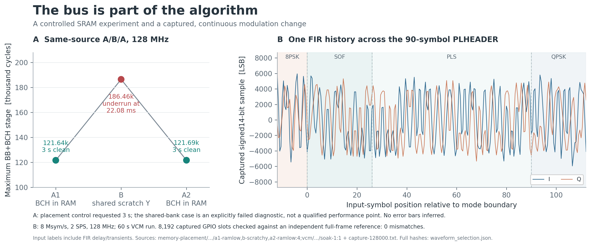
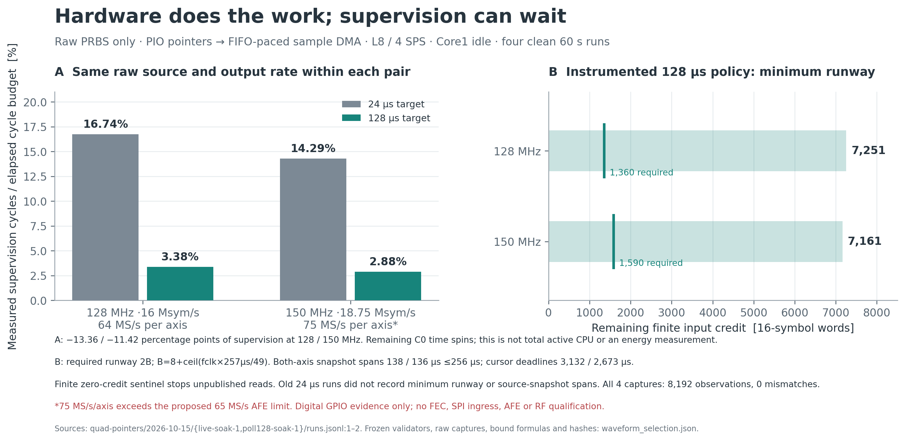
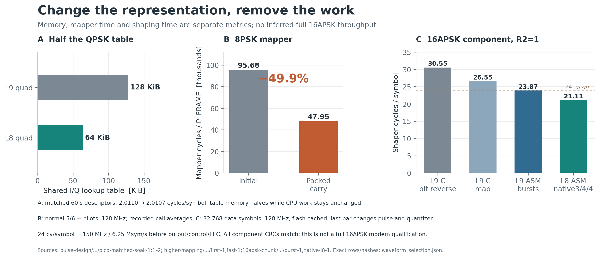

# Higher-order waveforms and architecture experiments

The complete transmitter now produces normal 5/6 8PSK, and can alternate QPSK and
8PSK PLFRAMEs without stopping the output clock or resetting filter history.
Both paths passed 60-second digital trials at 128 and 150 MHz. The fastest tested
BB data-field rate remains **25.844 Mb/s with QPSK at 16 Msym/s**. Higher-order
modulation currently provides a narrower-band alternative.

These experiments are on `experiment/yapogee-next-waveforms`. The earlier qualified
`experiment/yapogee-limits` checkpoint at `4b779c0` is retained. All hardware tests
used a Pimoroni Pico Plus 2, RP2350B rev A2, stock voltage, USB only, with external
GPIOs disconnected. The input master and waveform capture are on-chip. There is
no new external payload, AFE7071, RF spectrum/EVM or receiver-decode qualification.

## Complete digital modes

| Mode | Clock / symbol rate | Pulse | BB data-field capacity | Nominal occupied width | Evidence |
|---|---|---|---:|---:|---|
| QPSK 5/6 + pilots | 128 MHz / 16 Msym/s | L8, 4 SPS; 64 KiB table | 25.844 Mb/s | 19.2 MHz | [Matched 60 s L9/L8 runs](../../pulse-design/2026-10-15/pico-matched-soak-1/runs.jsonl) |
| 8PSK 5/6 + pilots | 128 MHz / 8 Msym/s | L9, 2 SPS; 128 KiB tables | 19.378 Mb/s | 9.6 MHz | [60 s runs](../../8psk-live/2026-10-15/bch-placement-soak-1/runs.jsonl) |
| 8PSK 5/6 + pilots | 150 MHz / 9.375 Msym/s | Same | 22.709 Mb/s | 11.25 MHz | Same |
| Alternating QPSK/8PSK 5/6 + pilots | 128 MHz / 8 Msym/s | Common L9, 2 SPS | 15.505 Mb/s mean | 9.6 MHz | [60 s VCM runs](../../vcm/2026-10-15/soak-1/runs.jsonl) |
| Alternating QPSK/8PSK 5/6 + pilots | 150 MHz / 9.375 Msym/s | Same | 18.170 Mb/s mean | 11.25 MHz | Same |

Capacity subtracts the 80-bit BBHEADER and includes PLHEADER/pilot time. It is not
application throughput. Width is the nominal `(1 + 0.20) × symbol_rate`, not a
measured spectrum. A higher clock is stated explicitly. VCM uses the same 2-SPS
engine and symbol rate for both modes; its QPSK frames do not run at the separate
16-Msym/s, 4-SPS QPSK setting.

Each positive trial checks all 8,192 observed I/Q bus halfwords at a single
reference offset, table/prefill CRCs, independent BBFRAME CRCs and the accepted SPI
message CRC chain. QPSK uses sparse physical-pin captures; 8PSK/VCM use contiguous
finite captures. These snapshots do not prove every transmitted sample.

The VCM host validator was independently reviewed after the first runs. Additive
revalidation records preserve the raw data while applying stricter firmware,
timing, capture-progress and encoder/ingress-accounting checks. The original
manifests, captures and run logs remain unchanged.

## Changes that mattered

### SRAM placement rescued the complete 8PSK pipeline

The first integrated image underruns after about 20 ms. Both cores were fetching
their hot shaper/BCH instructions from the same single-port SRAM bank. Moving
only the BCH section to striped low SRAM reduced its stage from about 176,300 to
121,500 cycles/frame, while shaping fell from about 13.34 to 12.09 cycles/symbol.
That is approximately **31% fewer BCH-stage cycles and 9% fewer shaping cycles**.

The [controlled A/B/A](../../memory-placement/2026-10-15/comparison.json) rebuilds
identical source with one section directive changed. Both A runs pass at both
clocks; the B runs fail with the same underrun. The [placement audit](sram-placement.md)
records addresses, source hashes and the original failure. This is the strongest
causal optimization result of the campaign.

The [RP2350 datasheet](https://datasheets.raspberrypi.com/rp2350/rp2350-datasheet.pdf)
describes the banked SRAM and arbitration; placing concurrent hot code in a
single small bank can serialize otherwise independent cores.

The 60-second fixed-8PSK runs measure 75.50–75.62% shaper work on core 0 and
92.07–92.09% ingress/encoder work on core 1. Core 0's number times the shaper;
it does not include its entire active loop. QPSK's current core-0 active-loop
measurement is broader, so those percentages must not be subtracted from each
other as a CPU-saving comparison. Waiting cores spin; unused timing budget is
not a measured sleep state or a power saving.

### Packed mapping removed whole operations

The new 8PSK mapper reads bit planes directly from the FEC columns, combines
mapping and Gold rotations with Boolean operations, and appends packed groups
across PLFRAME boundaries. It avoids constructing an interleaved-symbol array.
Normal-pilot mapping falls from **95,675 to 47,952 cycles/frame**. The QPSK packed
carry path falls from **90,386 to 70,619 cycles/frame**.

[Device mapper records](../../higher-mapping/2026-10-15/fast-1/runs.jsonl) and native
tests cover normal/short frames, pilots, all supported rates, partial groups,
ring wrap and independent scalar/primary-implementation references. Short-frame
8PSK retains its simpler general path. This is a mapper improvement, not a 50%
whole-transmitter improvement.

### A shorter pulse halves QPSK table storage

The L8, four-symbol-row QPSK profile uses **64 KiB instead of 128 KiB**. An offline
convex search optimized the finite filter; a separate Walsh/ensemble calculation
checked the actual rounded LUT response. The model includes DAC hold and reports
digital and held-response margins separately. The [selected coefficients](../../pulse-design/2026-10-15/selected.json),
[independent audit](../../pulse-design/2026-10-15/independent-audit.json) and
[derivation](pulse-design.md) pin the exact profile.

The matched 60-second 16-Msym/s QPSK 5/6 tests retain the same approximately
2.011 descriptor cycles/symbol and 86.0% core-0 active work. **This saves memory;
it does not demonstrate a CPU improvement.** Actual rounded held-model distortion
is about 1.420%, versus 1.531% for the L9 trial and 1.161% for the earlier L12
profile. These model terms exclude the physical AFE and RF chain. The tight
modeled margins warrant real measurement before selecting a flight pulse.

The [one-core campaign](../../pulse-design/2026-10-15/onecore-soak-1/runs.jsonl)
also passes 60 seconds at **10.667 Msym/s / 128 MHz** and **12.5 Msym/s / 150 MHz**,
with 95.43% and 95.34% core-0 active work respectively. This includes real QPSK
2/3 FEC/PL framing and output, using a synthetic BB source and an idle second
core. It does not qualify live SPI ingress at those one-core limits. Lower-rate
8/9.375-Msym/s one-core runs have about 74% active work.

The integrated image's 16-Msym/s QPSK active fraction is higher than the earlier
82.72% result on the `b29d1a7` image. Those builds differ in placement and other
code; this is not an isolated causal comparison. Both pass their recorded
60-second configurations. The 8PSK bank fix is not presented as a universal CPU
improvement for every waveform.

### SPI READY now enforces one hardware admission credit

The former IRQ-driven READY close could admit another transaction while the
receiver DMA was being rearmed. The revised PIO gate consumes a hardware credit
at chip-select start; software grants another only after preparing fresh receive
storage. Sticky faults propagate to the transmitter.

The [SPI audit](spi-admission.md) compares the old gate and new gate under forced
20–200 µs IRQ delays. The old gate fails the delayed controls. The new gate passes
all short controls and two 60-second, 20-µs-delay trials: **2,192,239 packets** with
exact CRC chains and no reported faults. This addresses admission integrity;
it does not increase the SPI clock. The 32-MHz wire has roughly 31.6-Mb/s raw
message-payload capacity before the selected framing/application overhead.

## Continuous waveform switching

`benchvcm` alternates real normal-5/6 PLFRAMEs: 22,194 symbols of 8PSK, followed by
33,282 symbols of QPSK. Each frame carries its own MODCOD, header, pilots and Gold
reset. MATYPE signals ACM as required for VCM. Both modes share a global π/8
rotation and the same two-plane pulse engine, so filter history and the physical
sample clock continue across the boundary.

The reference reconstructs BBFRAME → BCH/LDPC → PL mapping → continuous scalar
filtering. Each saved VCM capture includes the mode boundary and the entire next
90-symbol PLHEADER; corruption and false-boundary controls fail validation.
This establishes an autonomous digital switching experiment. There is no new
uplink, ground-command protocol or demonstrated receiver acquisition. A future
onboard command interface or stored plan can choose the frame pattern.

The primary specification is [ETSI EN 302 307-1 V1.4.1](https://www.etsi.org/deliver/etsi_en/302300_302399/30230701/01.04.01_60/en_30230701v010401p.pdf),
especially §§5.1.6, 5.3–5.6. All validation tools remain local and reproducible;
the host supplies test commands and references, not waveform samples or FEC.

The [independent VCM review](vcm-independent-review.md) checks signalling, the
shared constellation rotation, scratch storage, publication, borrowed SPI packet
lifetime and exact capture-boundary arithmetic. It also documents the host
validator defects found and repaired before the saved runs were requalified.

## Live PIO-generated addresses

Two pin-free PIO state machines now consume raw packed QPSK words and generate
the actual LUT addresses. Two control/sample-DMA pairs connect their RX FIFOs to
the output writers. Four more DMA channels enforce finite source credits. There
is no CPU descriptor generation or per-sample arithmetic in this experiment.

The [first 60-second runs](../../quad-pointers/2026-10-15/live-soak-1/runs.jsonl)
pass at 128 MHz / **16 Msym/s**, with **16.7364% measured core-0 supervision** and
core 1 idle. All 8,192 sparse observations match the independent L8 pulse model.
The source is immutable cyclic PRBS; these figures exclude SPI and FEC work.
Spinning between polls is excluded from the supervision timer. This is not a
whole-radio active-time comparison with the CPU-descriptor engine.

The 150-MHz / 18.75-Msym/s run also passes for 60 seconds, with 14.2916%
supervision. At 4 SPS that requires 75 MS/s per axis, above the proposed AFE7071's
[65-MS/s rating](https://www.ti.com/lit/ds/symlink/afe7071.pdf).
It is a digital architectural probe, not a usable AFE rate.

Finite-credit starvation controls stop on the credited prefix without issuing a
source read beyond the granted bound. The earliest 8-Msym/s quick tests failed
an unnecessarily strict 32-µs benchmark polling ceiling before capture or grant
freeze; pointer/output hardware fault flags remained clear. Those failures are
retained in [the first quick campaign](../../quad-pointers/2026-10-15/live-quick-1/runs.jsonl).
Cold flash-cache effects are a possible cause of the measured 35–42-µs startup
gap, not an established diagnosis. Before increasing the interval, we derived
explicit cursor and minimum-credit-runway bounds.

The [reviewed 128-µs polling campaign](../../quad-pointers/2026-10-15/poll128-soak-1/runs.jsonl)
then passes both 60-second fast-rate tests. Measured supervision falls to
**3.3803% at 16 Msym/s / 128 MHz**, and **2.8757% at 18.75 Msym/s / 150 MHz**,
about 80% less supervision work than the 24-µs polling baseline. Source, table,
waveform and output mode remain the same; both builds have exact sparse captures.
This is a comparison of the same instrumented supervision scope, not complete
radio CPU usage. The longer polling period does not increase the sample clock.

The [independently reviewed bound](pointer-polling-proof.md) limits actual source
snapshot spans to 256 µs, allowing another microsecond for timer quantization.
It requires at least 1,360/1,590 source words of credit runway at 128/150 MHz.
The runs observe minima of 7,251/7,161 words and maximum snapshot spans of
138/136 µs. All four short positive rate/clock combinations and four deliberate
starvation controls also pass. Native checks reject NaN timings, insufficient
credits, long snapshot gaps, read-past-credit and incorrect final cursor fences.

Cleanup stops output before the pointer producer. The producer latches its final
owned DMA read cursors after a successful abort, then releases channels. Native
lifecycle tests advance cursors during abort and poison released registers to
verify that final accounting uses the correct fence. The inherited output DMA
abort wait has no new timeout guarantee.

## 16APSK: a promising component, with explicit boundaries

Exact finite-coordinate chunks avoid a table indexed by an entire 16-ary filter
history. The L9 version shares edge tables using filter symmetry. Its assembly
burst kernel improves the same profile from 26.554 to **23.874 cycles/symbol**.
The L8 native 3+4+4-coordinate representation removes reversal work and reaches
**21.106 cycles/symbol** at both clocks, using 136 KiB of tables.

[L9 records](../../16apsk-chunk/2026-10-15/burst-1/runs.jsonl) and
[L8 records](../../16apsk-chunk/2026-10-15/native-l8-1/runs.jsonl) check the actual
Pico kernel CRCs. Native/ISA tests cover all six ring ratios, every partial table,
partitioned histories, rounding bounds and signed-lane safety. The two pulse
profiles/partial-rounding schemes differ; their timings are not a same-waveform
optimization comparison.

At 150 MHz and 6.25 Msym/s a core has 24 cycles/symbol, leaving roughly 12% after
this isolated kernel. Real output DMA, the complete 16APSK interleaver/mapper,
ingress, frame boundaries and bank contention have not been demonstrated together.
No complete 16APSK rate is claimed. Higher order also trades bandwidth for a
more demanding link/analog chain; more constellation points do not automatically
increase the CPU-limited downlink bitrate.

The chosen constellation uses the standard's explicit `R2=1` option. Header/pilot
coordinates fit that alphabet. It is distinct from a unit-data-energy whole-frame
normalization; the [independent normalization audit](16apsk-normalization.md)
explains the approximately 1.055-dB header/pilot versus average-data energy at γ=2.7.

## Next experiments worth doing

The [ranked follow-up analysis](next-experiments.md) prioritizes connecting the
hardware-address engine to real SPI/FEC production, bounded BCH work sharing
between the 8PSK cores, and a real DMA-fed 16APSK output test. Each needs a matched
baseline, independent waveform checks and a material improvement before becoming
a default.

32APSK remains mathematical/native-model research. Its larger coordinate alphabet
and indexing cost have no verified throughput advantage on this Pico. Small
instruction tweaks, unchecked overclocking and a claim of “zero CPU” for a pipeline
that still needs supervision are not substitutes for complete measurements.

## Final checks

The [validation record](validation.json) links seven passing hardware/capture
qualification groups, the complete `make check` output and warning-free builds
of both firmware targets. The [final board record](final-board.json) identifies
the verified USB bench image, restored to 128 MHz after transmission stopped.
The new image also passes a fresh 60-second full SPI-fed QPSK 5/6 test and short
VCM regressions. Generated UF2/ELF copies remain local; committed manifests,
flash records, source archives and hashes retain their provenance.
